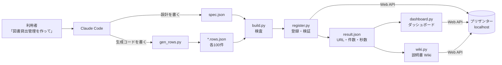

# 解説: Claude Code でプリザンターのアプリを自動作成する（2026年10月時点）

> この資料は、筆者が個人で作成した非公式のメモです（多くを AI が書いています）。プリザンターの正確な仕様は公式マニュアル（原稿: https://github.com/Implem/Implem.Pleasanter.Manual ）を参照してください。

## 要約（3行）

1. アプリ名を伝えるだけで、テストデータ（各テーブル100件）付きのプリザンターアプリを、ローカル環境に API で登録できるようにした。
2. Claude が書くのは「設計（spec.json）」と「データ生成（gen_rows.py）」の2つだけ。ID 採番・リンクの付け替え・登録・検証は Python スクリプトが行う。
3. 中心の検証アプリ「SaaS営業 顧客・案件管理」（4テーブル × 100件）は、指示から完成まで約2分、登録処理は 7.9 秒で終わり、検証の不一致は 0 件だった。さらに同じ spec.json から、ダッシュボード、Claude API を呼ぶ AI 機能（AI商談アシスト）、説明書の Wiki も生成した。

## プリザンターの性質と AI（要点）

- **一次情報が公開されている**: 本体のソースは OSS（GitHub `Implem/Implem.Pleasanter`、AGPL-3.0）、マニュアルの原稿も GitHub（`Implem/Implem.Pleasanter.Manual`、日本語 .md 1,592ファイル）で公開されている。AI がこれを読んで仕様を確定できたので、試行錯誤が減った。
- **設定はすべて JSON、操作はすべて API**: spec.json 1つから、テーブル・ダッシュボード・AI機能・Wiki まで作れた。
- **アプリ内から外部 AI を直接呼べる**: サーバースクリプトの `httpClient` だけで、中継サーバーなしに AI 機能を組み込めた。

詳しくは [01 プリザンターの性質と AI](01_プリザンターの性質とAI.md) を参照。

## 目次

| 章 | 内容 |
|---|---|
| [01 プリザンターの性質と AI](01_プリザンターの性質とAI.md) | 公開された一次情報・JSON の設定・API・サーバースクリプトが、作成時の検証でどう効いたか |
| [02 目的と作業の流れ](02_目的と作業の流れ.md) | 3つの目標と、作業の時系列 |
| [03 全体アーキテクチャ](03_全体アーキテクチャ.md) | Claude Code / CLAUDE.md / スキル / reference / scripts / プリザンター API の関係 |
| [04 パイプライン](04_処理パイプライン.md) | spec → gen_rows → build → register → verify の流れと入出力 |
| [05 プリザンターの仕様の確認と実装メモ](05_プリザンターの仕様理解.md) | ソースとマニュアルの使い分け、確認済みの事実、方式の転換 |
| [06 高速化の工夫](06_高速化の工夫.md) | BulkUpsert、依存段階ごとの並列登録、調査の省略、計測値 |
| [07 Claude Code の構成](07_ClaudeCodeの構成.md) | CLAUDE.md・スキル・settings.json の役割分担、サブエージェントの使い方 |
| [08 品質と安全](08_品質と安全.md) | build の検査、register の自動検証、安全策 |
| [09 ダッシュボード](09_ダッシュボード.md) | ダッシュボードの仕組み、spec の書き方、KPI の検証 |
| [10 実績](10_実績.md) | 作成したアプリの一覧と数値 |
| [11 振り返りと今後](11_振り返りと今後.md) | 分かったこと、未対応の事項 |
| [12 AI機能の組み込み](12_AI機能の組み込み.md) | サーバースクリプトから Claude API を呼ぶ仕組み、10秒の制約、キーの扱い |
| [13 説明書の自動生成](13_説明書Wikiの自動生成.md) | spec.json から説明書を作り、Wiki として登録する |

## 全体像

## 前提と用語

- 対象: ローカルのプリザンター（`http://localhost:59803`）。接続先と API キーはプロジェクト直下の `secret.txt` にあり、スクリプトだけが読む。本資料には API キーの値を載せていない。
- ユーザーは LoginId（`Tenant1_UserN`）で表記する。
- 「テーブル」はプリザンターのサイト（ReferenceType=Results）を指す。
- 「スキル」は Claude Code のスキル機能（`.claude\skills\pleasanter-app\`）を指す。
- パスは `C:\Implem\pleasanter-app-builder\` を基準にする。スキルのフォルダを `S`（`.claude\skills\pleasanter-app`）、アプリごとの作業フォルダを `O`（`output\<アプリ名>`）と略す。

## 一次資料

| 種類 | 場所 |
|---|---|
| プロジェクトのルール | `CLAUDE.md` |
| 権限設定 | `.claude\settings.json` |
| スキル本体 | `S\SKILL.md` |
| 仕様メモ・API 要約・設定の早見表 | `S\reference\`（spec-format / package-format / api / settings-catalog / sources） |
| スクリプト | `S\scripts\`（plapi / build / register / env / datagen / delete / dashboard / wiki、kpi_template.html、ai_script.js） |
| 見本 | `S\examples\it-assets\`（spec.json / gen_rows.py） |
| 作成したアプリの実績 | `output\<アプリ名>\spec.json`、`result.json` |
