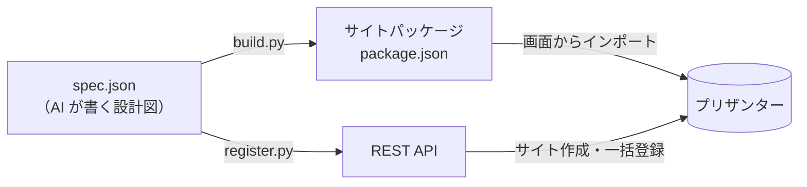
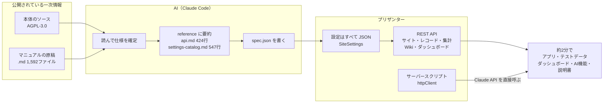

# 01 プリザンターの性質と AI

> この資料は、筆者が個人で作成した非公式のメモです（多くを AI が書いています）。プリザンターの正確な仕様は公式マニュアル（原稿: https://github.com/Implem/Implem.Pleasanter.Manual ）を参照してください。

作成時の検証では、約2分で動くアプリまでできた。これには、**AI が一次情報（ソースとマニュアル）を読めて、設定を JSON で書けて、API で最後まで操作できる**という、プリザンター側の性質が関係している。この章では、その性質を事実と実測値で示す。

## 1. 一次情報が公開されている

| 公開物 | 場所 | 内容 |
|---|---|---|
| 本体のソース | GitHub `Implem/Implem.Pleasanter`（公開リポジトリ） | ライセンスは AGPL-3.0。リポジトリの説明は "no-code/low-code development platform that runs on .NET" |
| マニュアルの原稿 | GitHub `Implem/Implem.Pleasanter.Manual`（公開リポジトリ） | 日本語の原稿は `ja/docs` 配下に .md が1,592ファイル。誤りの指摘や改善提案を Issue / Pull Request で受け付けている（README に記載。PR はここではマージせず、社内リポジトリに取り込んでから同期する運用） |

- ソースは公開リポジトリ `Implem/Implem.Pleasanter` を `C:\Implem\Implem.Pleasanter` にクローンして参照する（手順は `環境構築手順.md`）。LICENSE は GNU AGPL v3。
- AGPL-3.0 では、改変したものをネットワーク経由で利用者に提供する場合、その改変後のソースを開示する義務がある。利用条件は自社の使い方に合わせて確認すること。

## 2. アプリを登録する2つの手段: サイトパッケージと API

プリザンターには、アプリ（テーブルの構成と設定）を外から持ち込む手段が2つある。どちらも設定を JSON で表すので、AI が書いたものをそのまま登録できる。

| 手段 | 中身 | 登録のしかた | 向いている場面 |
|---|---|---|---|
| **サイトパッケージ** | フォルダ・テーブルの構成と設定（SiteSettings）、リンク、ビュー、通知、リマインダー、必要ならデータ・アクセス権までを1つの JSON にまとめたもの | 画面の「管理 → サイトパッケージのインポート」でファイルを選ぶ。「データを含める」などを選べる。エクスポートも画面から | 別の環境への持ち運び、配布、ハンズオンの教材。API キーやスクリプトがなくても取り込める |
| **API でアプリを登録** | サイトの作成（CreateSite に SiteSettings の JSON を渡す）・更新・削除、レコードの一括登録（BulkUpsert）、集計の同期、Wiki・ダッシュボードの作成 | スクリプトから REST API を呼ぶ。画面操作なし | 自動化。作成・検証・作り直しを繰り返すとき。設定だけの手直し |

- このプロジェクトでは両方を使う。`make_app.py` は API で登録まで行い（既定）、`--no-register` を付けるとサイトパッケージ（`package.json`）だけを出力する。
- API キーではサイトパッケージを取り込めない（API でできるのは既存サイトのコピーだけ。`ItemModel.CopySitePackageByApi`）。
  そのため、API で登録するときは、サイトパッケージを経由せずにサイトとレコードを直接作る。
- どちらも中身は同じ SiteSettings の JSON なので、AI が書いた設計図から両方を生成できる。手段を選べることで、
  「API で素早く試し、決まったらサイトパッケージにして配る」という使い分けができる。

## 3. 効いたこと

| 性質 | 具体例 | 根拠・実測値 |
|---|---|---|
| **AI がソースを読んで仕様を確定できる** | API キーではサイトパッケージを取り込めないことに、試す前に気づいた | `ItemModel.CopySitePackageByApi`（既存サイトのコピーだけ） |
| | 拡張列はエディタか一覧に置かないと Get で返らない | `SiteSettings.ReadableColumns`（SiteSettings.cs:4190） |
| | Aggregation.Type は3種のみ。誤った値は SiteSettings 全体を null にする | Aggregation.cs:7-12、Jsons.cs:22-31 |
| | ダッシュボードの CustomHtml のスクリプトは非同期読み込みのときだけ動く | DashboardUtilities.cs:1450 |
| | サーバースクリプトは10秒で打ち切られる | Script.json の ServerScriptTimeOut=10000 |
| | サーバースクリプトの `items.Get` は .NET 配列を返す（件数は `.Length`） | 実地確認 |
| **AI がマニュアルから最適な API を見つけられる** | BulkUpsert（Keys 省略で全件新規作成）を見つけた | 300回の個別 Create が、1テーブル1回の呼び出しになった |
| **読み取った結果が再利用できる資産になる** | サブエージェントが要約した reference を、次のアプリから使う | 使い勝手テストでは、ソース・マニュアルの参照0回でアプリが完成 |
| **設定がすべて JSON で表せる** | spec.json 1つから、テーブル・ダッシュボード・AI機能・説明書 Wiki まで生成した | SiteSettings / サイトパッケージ。生成・検査・差分管理がテキストでできる |
| **API で最後まで操作できる** | サイトの作成・更新・削除、一括登録、集計の同期、Wiki、ダッシュボード | すべて REST API。画面操作なし |
| **アプリ内から外部 AI API を直接呼べる** | 案件の「AI商談アシスト」 | サーバースクリプトの `httpClient` だけで実装。中継サーバーなし。1件4〜5秒 |
| **セルフホストできる** | すべて自社環境の localhost で完結した | データの置き場所を自分で管理できる |

特に「黙って null になる」「件数が undefined になる」のようにエラーにならない挙動は、試すだけでは原因にたどり着きにくく、ソースを読めたことが役に立った。

## 4. 速度の実績

| 指標 | 値 |
|---|---|
| アプリ名の指示から完成まで | 約2分（SaaS営業 顧客・案件管理、4テーブル × 100件） |
| 登録処理 | 7.9秒（サイト作成 1.0 / データ投入 5.9 / 通知・集計 0.6 / 検証 0.4） |
| 事情を知らないエージェントによる再現 | 約2分5秒、エラー0（図書貸出管理） |
| AI機能の1回の実行 | 4.0〜4.8秒（サーバースクリプトの上限10秒以内） |

## 5. このやり方でできること

業務を知っている人の言葉（アプリ名と一言の説明）から、次のものを数分で用意できる。

- 動くアプリ（テーブル・リンク・計算式・集計・ビュー・通知・リマインダー）
- もっともらしいテストデータ
- ダッシュボード
- アプリに組み込んだ AI 機能
- 説明書（Wiki）

画面のない要件定義の段階でも、動くものを見ながら話せる。直したら数分で作り直せるので、要件の確認や PoC を何度も回せる。
