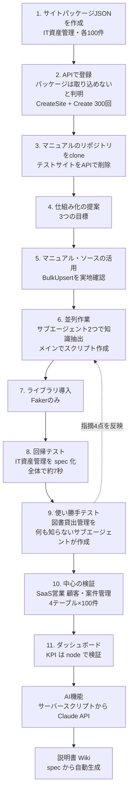

# 02 目的と作業の流れ

> この資料は、筆者が個人で作成した非公式のメモです（多くを AI が書いています）。プリザンターの正確な仕様は公式マニュアル（原稿: https://github.com/Implem/Implem.Pleasanter.Manual ）を参照してください。

## 2.1 出発点

最初の依頼は、プリザンターのサイトパッケージ「消耗品管理の例.json」を参考にして、IT資産管理アプリのサイトパッケージ JSON を作ることだった（サンプルデータは各テーブル100件）。

1本のアプリを作ること自体はできた。ただ、別のアプリを作るたびに同じ調査とスクリプト作成を繰り返すことになる。そこで、途中から次の3つの目標を立てて仕組み化した。

## 2.2 3つの目標

| # | 目標 | 実現方法 | 結果 |
|---|---|---|---|
| 1 | アプリ名を言うだけで、テストデータ付きのアプリができる | スキル `pleasanter-app` に手順・既定値・設計ガイドを書いた。アプリ名だけ渡されたら確認せずに既定値で最後まで進める | 「図書貸出管理」「SaaS営業 顧客・案件管理」をこの方法で作成 |
| 2 | 時間を短くする（スキル化・並列化） | BulkUpsert による一括投入、依存段階ごとの並列登録、調査結果の文書化 | 登録処理: 300回の個別 Create から 4.7 秒へ（IT資産管理、3テーブル × 100件） |
| 3 | 短いプロンプトで済むようにする | 指示を CLAUDE.md / SKILL.md / reference にまとめた | 事情を知らないサブエージェントが、ソースもマニュアルも参照せずに約2分5秒で完成させた |

## 2.3 中心となる考え方

> Claude が書くのは **spec.json（設計）** と **gen_rows.py（データ生成）** だけ。
> ID 採番・リンクの付け替え・登録・検証はスクリプトに任せる。

この分担にした理由は次のとおり。

- 設計とデータの中身（業務としてもっともらしい値）は、アプリごとに考える必要がある。ここは LLM に向いている。
- ID の対応付け、ユーザー・部署の変換、SiteSettings の細かい型などは決まった手順で処理できる。ここを毎回 LLM に書かせると、間違いが入りやすく時間もかかる。

## 2.4 作業の流れ

## 2.5 各段階の要点

| 段階 | やったこと | 分かったこと・決めたこと |
|---|---|---|
| 1 サイトパッケージ作成 | プリザンターのソース（ResultExportModel、取り込み処理 `Utilities.cs`、`IdConvertUtilities`）を読んで JSON を Python で生成した | ユーザーは LoginId → UserCode → 名前、部署は DeptCode → 名前の順で照合される。リンク列は旧 ResultId を書き、Links に定義した列だけが置換される。Summary は取り込み時に再計算されない |
| 2 API 登録 | ソースを読んで方式を変えた | API キーではサイトパッケージファイルを取り込めない（`CopySitePackage` はサーバ上の既存サイトをコピーするだけ）。CreateSite / Create / UpdateSite で組み立てる方式に切り替えた。通知・リマインダーはデータ投入後に有効化した |
| 3 準備 | マニュアル（GitHub の Implem/Implem.Pleasanter.Manual、公開リポジトリ）を `C:\Implem` に clone。テストサイトは削除前に GetSite で対象を確認してから API で削除した | |
| 4 提案 | 3つの目標を受けて構成を提案した | 2.3 の分担 |
| 5 マニュアル活用 | BulkUpsert を見つけて実地テストした | Keys を省略すると全件新規作成になる。計算式・Summary も動く。SynchronizeSummaries も動く。拡張列はエディタか一覧に置かないと Get で返らない |
| 6 並列作業 | 知識の抽出をサブエージェント2つに任せ、その間にメイン側で BulkUpsert の検証とスクリプトを作成した | サブエージェントの指摘で誤り2つを修正した（Aggregation.Type、Version 1.017）。BulkUpsert は「インポート後」通知が未設定でも送ることも分かった |
| 7 ライブラリ | Faker（日本語ダミーデータ）だけを導入した | `python -I` だとユーザーの site-packages が読めないので `-P` にした。文字化け対策に `PYTHONUTF8=1` を付けた |
| 8 回帰テスト | IT資産管理を spec 化して、パイプライン全体を通した | 合計約7秒（登録処理は 4.7 秒） |
| 9 使い勝手テスト | 事情を知らないサブエージェントに CLAUDE.md と SKILL.md だけを渡した | 約2分5秒で完成、エラー0。指摘4点を反映した |
| 10 中心の検証 | 「BtoB向けSaaSを販売する営業の顧客・案件管理システム」をスキル経由で作成した | 約2分で完成、登録処理は 7.9 秒 |
| 11 ダッシュボード | spec に `dashboards` を書き、`dashboard.py` で作成・更新する | 09章 |
| AI機能 | 案件に「AI商談アシスト」を入れた。サーバースクリプトから Claude API を呼ぶ | 12章 |
| 説明書 | spec から説明書を生成し、Wiki として登録した | 13章 |

## 2.6 参考: 作業ファイルの更新時刻

`output\` と スキルのフォルダに残っているファイルの更新時刻（ローカル時刻）を並べると、順序は次のとおり。

| 時刻 | ファイル | 段階 |
|---|---|---|
| 05:10 | `IT資産管理.json`（サイトパッケージ） | 1 |
| 05:25〜05:31 | `scripts\plapi.py` など、`output\IT資産管理\result.json` | 6〜8 |
| 05:36 | `output\図書貸出管理\result.json` | 9 |
| 05:40〜05:41 | `reference\settings-catalog.md`、`package-format.md`、`spec-format.md` | 9 の指摘の反映 |
| 05:47 | `output\SaaS営業 顧客・案件管理\result.json` | 10 |
| 05:53 | `scripts\dashboard.py`、`kpi_template.html` | 11 |

ファイル上では、サイトパッケージの出力（05:10）から中心の検証アプリの登録（05:47）までが約37分である。段階 1 の調査はこれより前に始まっているので、作業全体の所要時間ではない。

## 2.7 この資料で伝えたいこと

| 観点 | 要点 | 詳しい章 |
|---|---|---|
| 仕組み | LLM には設計とデータの中身だけを書かせ、決まった処理はスクリプトに任せる | 02、03 |
| 仕様の調べ方 | マニュアルで機能を探し、ソースで型と既定値を確かめ、実地で挙動を確かめる。分かったことは文書に残す | 04 |
| 速さ | API の呼び出しをまとめ、依存関係に沿って並列にし、調べ直しをなくす | 05 |
| 短い指示 | ルール・手順・知識を CLAUDE.md / SKILL.md / reference に分け、必要なときだけ読ませる | 06 |
| 品質と安全 | 登録前の検査、登録後の自動検証、外に出さない・消しすぎない仕組み | 07 |

> **プリザンターの性質との関係**: 段階1・2の方針転換（パッケージ取り込みから API の組み立てへ）は、試して失敗する前に、公開されている本体のソースを読んで決められた。段階5の BulkUpsert は、公開されているマニュアルの原稿から AI が見つけた。
