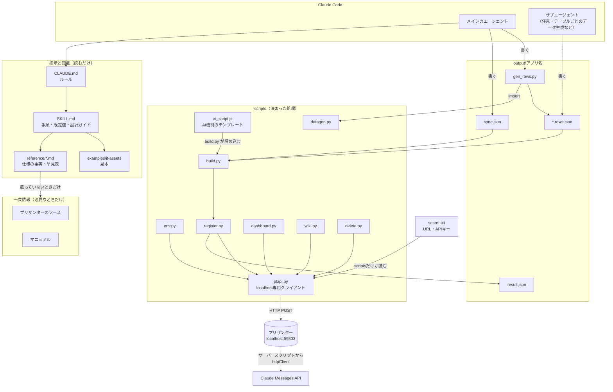
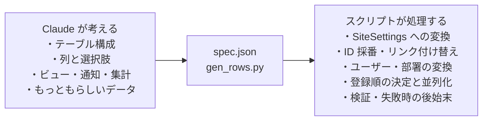

# 03 全体アーキテクチャ

> この資料は、筆者が個人で作成した非公式のメモです（多くを AI が書いています）。プリザンターの正確な仕様は公式マニュアル（原稿: https://github.com/Implem/Implem.Pleasanter.Manual ）を参照してください。

## 3.1 構成要素

| 要素 | 場所 | 役割 |
|---|---|---|
| Claude Code | — | 依頼を受けて、spec.json と gen_rows.py を書き、スクリプトを実行する |
| CLAUDE.md | `C:\Implem\pleasanter-app-builder\CLAUDE.md`（19行） | プロジェクトのルール。「アプリの作成・削除はスキルで行う」「キーは出さない」「接続先は localhost のみ」「Python の実行方法」など |
| settings.json | `.claude\settings.json` | 確認なしで実行してよいコマンドの許可リスト |
| スキル | `S\SKILL.md`（63行） | 手順・既定値・設計ガイド・時間をかけないための注意 |
| reference | `S\reference\` | 仕様の事実（package-format）、spec の書き方（spec-format）、API の要約（api）、SiteSettings の早見表（settings-catalog）、調べ物の索引（sources） |
| scripts | `S\scripts\` | 決まった処理をすべて受け持つ Python スクリプト群 |
| examples | `S\examples\it-assets\` | 完全な見本（spec.json と gen_rows.py） |
| 一次情報 | `C:\Implem\Implem.Pleasanter\Implem.Pleasanter`（ソース）、`C:\Implem\Implem.Pleasanter.Manual\ja\docs`（マニュアル） | reference にない設定を使うときだけ引く |
| プリザンター | `http://localhost:59803` | 登録先。Web API（`/api/items/{id}/{action}`）で操作する |

## 3.2 関係図

## 3.3 層ごとの責任分担

Claude 側の成果物を2つに絞ったことで、次の利点がある。

- spec は「何を作るか」だけの宣言になる。例えばリンクは `{"name": "ClassA", "link": "assets"}` と書くだけで、`ChoicesText`（`[[サイトID]]`）、`Link: true`、`Links[]` は build.py が生成する。
- SiteSettings の型の誤り（例: Aggregation.Type に範囲外の値を入れると SiteSettings 全体が null になる）を spec の段階で検査できる。
- 同じ spec と rows から、API 登録（register.py）とサイトパッケージ JSON（`build.py --package`）の両方を作れる。

## 3.4 スクリプト一覧

| スクリプト | 行数 | 役割 |
|---|---|---|
| `plapi.py` | 78 | API クライアント。`secret.txt` を読み、localhost 以外なら例外で止める。Get の全件ページングもここで行う |
| `env.py` | 41 | 接続先のユーザー・部署・グループを取得して `output\env.json` に保存する（無効・ロック中のユーザーは除く） |
| `datagen.py` | 70 | gen_rows.py から使う生成ヘルパー `Gen`（user / dept / date / days_ago / pick / money / write、`g.fake`=Faker ja_JP） |
| `build.py` | 556 | spec → SiteSettings の変換、rows の検査、登録順（依存段階）の計算、サイトパッケージ JSON の出力 |
| `register.py` | 222 | サイト作成 → データ投入 → 通知・集計 → 検証 を実行し、`result.json` を書く。失敗時はフォルダを削除する |
| `dashboard.py` | 142 | spec の `dashboards` から、ダッシュボードのサイトを作成・更新する |
| `kpi_template.html` | 138 | ダッシュボードの CustomHtml パーツに埋め込む KPI テンプレート |
| `wiki.py` | — | spec.json から説明書（Markdown）を生成し、Wiki として登録・更新する（13章） |
| `ai_script.js` | — | AI機能のサーバースクリプトのテンプレート。build.py が設定を埋め込む（12章） |
| `delete.py` | 33 | サイトを削除する。`--yes` なしでは対象を表示するだけ |

使っている外部ライブラリは Faker だけで、HTTP は標準ライブラリの `urllib.request` で送っている。行数は最初に書いた時点のもので、その後の改修（AI機能・`--update-settings` など）で build.py / register.py / dashboard.py は増えている。

## 3.5 実行環境のポイント

- Python は `PYTHONUTF8=1 python -P <script>` で実行する（CLAUDE.md、SKILL.md に記載）。
  - `-P`: カレントディレクトリを `sys.path` に入れない。`-I` も試したが、ユーザーの site-packages まで無効になって Faker を読めなかった。
  - `PYTHONUTF8=1`: Windows の既定のコードページ（cp932）で入出力されて文字化けするのを防ぐ。なお `output\IT資産管理\run.log` は UTF-8 として読むと日本語が化けるので、cp932 で書かれたものと思われる（書かれた経緯は未確認）。
- 作業ファイルはすべて `output\<アプリ名>\` に置く。settings.json の Read / Edit / Write の許可もこのフォルダに限っている。

> **プリザンターの性質との関係**: この構成が成り立つのは、プリザンターの設定がすべて JSON（SiteSettings）で表せて、サイトの作成からレコードの一括登録・集計の同期・Wiki・ダッシュボードまで REST API で操作できるからである。画面操作を自動化する仕組みは要らなかった。
