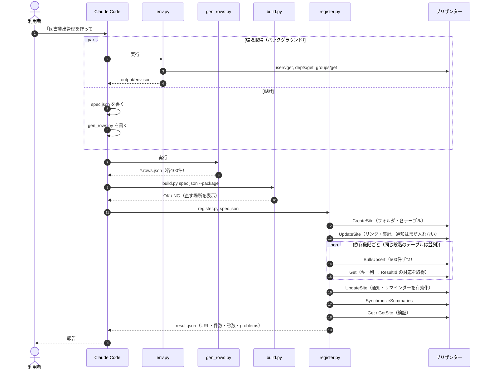
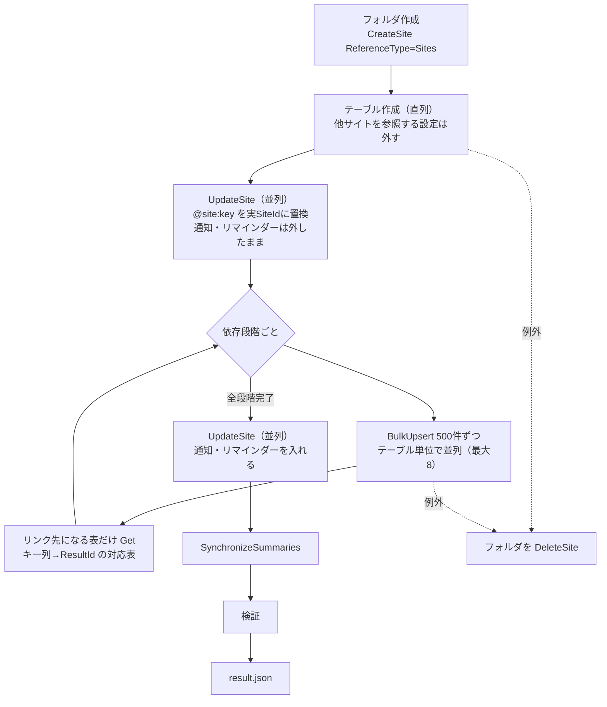

# 04 パイプライン

> この資料は、筆者が個人で作成した非公式のメモです（多くを AI が書いています）。プリザンターの正確な仕様は公式マニュアル（原稿: https://github.com/Implem/Implem.Pleasanter.Manual ）を参照してください。

## 4.1 全体の流れ

SKILL.md の手順は次の6段階である。

| # | 段階 | 担当 | 入力 → 出力 |
|---|---|---|---|
| 1 | 環境取得 | `env.py`（バックグラウンドで開始。1日以内に取得済みなら省略可） | API → `output\env.json`（ユーザー・部署・グループ） |
| 2 | 設計 | Claude | spec-format.md と見本 → `O\spec.json` |
| 3 | データ生成 | Claude が書いた `gen_rows.py` | spec・env.json → `O\<key>.rows.json` |
| 4 | 検査 | `build.py` | spec・rows → OK/NG、`O\package.json` |
| 5 | 登録・検証 | `register.py` | spec・rows → プリザンター、`O\result.json` |
| 6 | 報告 | Claude | result.json → URL、件数、機能、警告、所要時間 |

## 4.2 シーケンス図



NG が出た場合は、Claude が spec / gen_rows を直して 4 からやり直す。SKILL.md には「失敗したら推測で直さず、register.py / build.py のエラー文を読む」と書いてある。

## 4.3 spec.json の例（抜粋）

中心の検証アプリ「SaaS営業 顧客・案件管理」の案件テーブルから抜粋した。

```json
{
  "key": "deals", "title": "案件", "keyColumn": "ClassA",
  "status": [[100, "リード", "リ", "status-new"], [900, "受注", "受", "status-closed"]],
  "columns": [
    {"name": "ClassA", "label": "案件番号", "required": true},
    {"name": "ClassB", "label": "顧客", "link": "customers", "required": true},
    {"name": "NumA", "label": "ライセンス数", "Unit": "ID"},
    {"name": "NumB", "label": "月額単価", "format": "C"},
    {"name": "NumC", "label": "MRR", "format": "C", "readOnly": true}
  ],
  "formulas": [{"target": "NumC", "expr": "NumA * NumB"}],
  "summaries": [{"to": "customers", "column": "NumA", "link": "ClassB",
                 "type": "Total", "source": "NumC", "sourceView": "受注"}],
  "views": [{"name": "受注", "filter": {"Status": [900]}}],
  "notifications": [{"subject": "案件を受注しました", "to": "[Manager],[Owner]",
                     "monitor": ["Status", "NumC"], "afterView": "受注"}]
}
```

（実際の status は7段階、columns は19列。ここでは一部だけ載せた）

spec では、プリザンター内部の ID や型を意識しなくてよいようにしている。

| spec の書き方 | build.py / register.py が作るもの |
|---|---|
| `"link": "customers"` | `ChoicesText: "[[@site:customers]]"`、`Link: true`、`Links[]`。`@site:` は登録時に実際の SiteId に置換 |
| `"choices": "@depts"` | `ChoicesText: "[[Depts]]"`。rows の部署名を DeptId に変換 |
| `"expr": "NumA * NumB"` | Formula の式ツリー（`OperatorType` 3 = 乗算） |
| `"sourceView": "受注"` / `"afterView": "受注"` | ビュー名 → ビュー ID（1から採番） |
| `"filter": {"Status": [900]}` | `ColumnFilterHash: {"Status": "[\"900\"]"}`（JSON 文字列） |
| `"repeat": "daily"` | Reminder の `Type: 10` |

## 4.4 rows の例

rows は「1行 = 列名 → 値」のフラットな配列で書く。以下は `deals.rows.json` の1件目（抜粋）。

```json
{"ClassA": "D-2025-0026", "ClassB": "C-0088", "Title": "経費精算・ワークフロー導入（Business）",
 "Status": 910, "ClassC": "新規", "ClassD": "Business", "NumA": 85, "NumB": 1980,
 "DateA": "2025-12-20", "DateB": "2026-03-03", "Owner": "Tenant1_User4", "ClassF": "時期延期"}
```

- リンク列 `ClassB` には、リンク先（顧客）の業務キー `C-0088` を書く。ResultId への変換は register.py が行う。
- ユーザー列 `Owner` は LoginId で書く（名前や UserId でもよい）。
- 計算式の結果（`NumC` = MRR、`NumD` = 年間契約額）と Summary の書き込み先は書かない。プリザンターが計算する。

## 4.5 gen_rows.py の例（抜粋）

gen_rows.py は `datagen.Gen` を使う。以下は見本（IT資産管理）の冒頭である。

```python
g = Gen(os.path.dirname(os.path.abspath(__file__)), seed=20261016)
IT_STAFF = g.users(2)          # env.json の実在ユーザーから選ぶ（UserId 1〜2 の管理者は除く）
...
status = 900 if end < TODAY and g.rnd.random() < 0.35 else g.pick([200, 100, 400], [85, 10, 5])
```

- `seed` を固定しているので、何度実行しても同じデータになる。
- 日付は `TODAY`（実行日）を基準にする。期限が近いものや期限切れのものが、実行日に応じて必ず含まれる。
- `g.write(key, rows)` は date 型を ISO 形式の文字列にして `O\<key>.rows.json` を書く。

## 4.6 register.py の内部処理



- テーブルの作成だけは直列にしている。並列にするとメニューの並び順が spec の順にならないためで、1件あたり約0.1秒しかかからない（register.py のコメントによる）。
- BulkUpsert のレスポンスには新しい ResultId が含まれない。そこで、リンク先になるテーブルだけを投入後に Get し、キー列から ResultId への対応表を作って次の段階で使う。
- 検証の内容は 07 章で説明する。

> **プリザンターの性質との関係**: spec と rows はただの JSON で、プリザンターの SiteSettings とレコードも JSON である。そのため変換・検査・差分の確認を、すべてテキストとスクリプトで行える。同じ spec から API 登録とサイトパッケージの両方を出せるのも、このためである。
