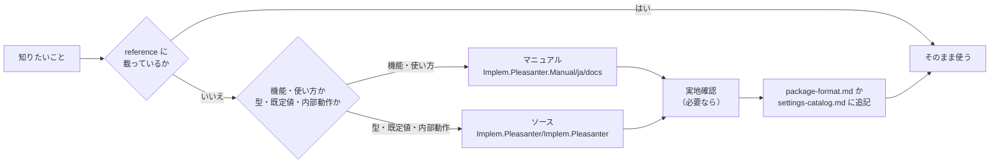
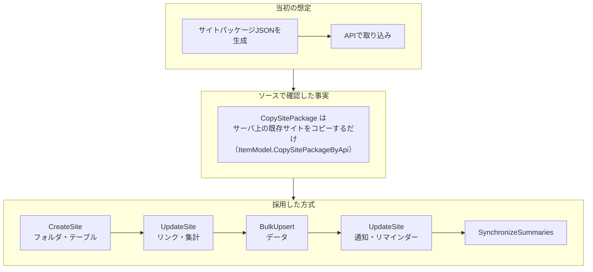

# 05 プリザンターの仕様の確認と実装メモ

> この資料は、筆者が個人で作成した非公式のメモです（多くを AI が書いています）。プリザンターの正確な仕様は公式マニュアル（原稿: https://github.com/Implem/Implem.Pleasanter.Manual ）を参照してください。

## 5.1 情報源の使い分け

調べるときの順番は `reference\sources.md` に決めてある。

| 情報源 | 向いていること | 例 |
|---|---|---|
| マニュアル | どんな API・機能があるか、画面の設定項目の意味 | BulkUpsert（Keys を省略すると全件新規作成）を見つけた |
| ソース | プロパティ名・型・enum の値・既定値・実際の処理順 | `CopySitePackage` の中身、`SiteSettings.ReadableColumns`、Aggregation.Type の範囲 |
| 実地確認 | マニュアルにもソースの読解にも頼り切れない挙動 | BulkUpsert で計算式・Summary が動くこと、SynchronizeSummaries の動作 |

reference の2つの早見表は、サブエージェントがそれぞれ抽出した（07章）。

- `reference\api.md`（424行）: マニュアルの API 章の要約。マニュアルとソースで食い違う点には「⚠ソース」を付けた。
- `reference\settings-catalog.md`（547行）: ソースの `Libraries\Settings\` から作った SiteSettings の早見表。各行に根拠のファイルと行番号（例 `Aggregation.cs:7-12`）を付けた。

## 5.2 方式の転換: サイトパッケージから API の組み立てへ

最初はサイトパッケージ JSON を作って取り込むつもりだった。しかしソースを読むと、API キーではパッケージファイルを取り込めないことが分かった。

最初は Create を1件ずつ呼んで登録した（3テーブル × 100件 = 300回）。その後マニュアルで BulkUpsert を見つけ、一括投入に切り替えた（06章）。

サイトパッケージ JSON の出力（`build.py --package`）は、画面からインポートする用途のために残してある。SKILL.md の引数「登録しない」を指定すると、検査の後で止めて package.json を渡す。

## 5.3 確認済みの事実（API で登録するとき）

`reference\package-format.md` から抜粋した。

| 事実 | 根拠 | 対処 |
|---|---|---|
| CreateSite の URL の id は親サイト ID（0 = トップ）。SiteSettings は必須 | `SiteUtilities.CreateByApi` | フォルダを作ってから、その配下にテーブルを作る |
| UpdateSite は SiteSettings を丸ごと置き換え、Links テーブルも登録し直す | `SiteModel.SetByApi` | 部分更新ではなく、毎回完全な設定を送る |
| DeleteSite はフォルダ配下のサイト・レコードもまとめて削除する（ごみ箱行き） | `SiteModel.Delete` | 失敗時の後始末はフォルダを消すだけでよい |
| BulkUpsert は Keys を省略すると全件新規作成。レスポンスは件数メッセージだけで、新しい ID は返らない | 実地確認 | 投入後に Get でキー列 → ResultId の対応を取る |
| BulkUpsert でも計算式（Formulas）と集計（Summaries）は動く | 実地確認（子の投入で親の NumB が更新された） | 集計値を自分で計算しない |
| SynchronizeSummaries で集計を再計算できる（`SummaryId` に Id の配列） | 実地確認 | 登録の最後に呼ぶ |
| Get や書き込みで扱える拡張列は、エディタ（EditorColumnHash）か一覧（GridColumns）に置いた列だけ | `SiteSettings.ReadableColumns`（SiteSettings.cs:4190） | キー列は必ずエディタに置く。build.py は既定で全列をエディタに置く |
| Get は既定で200件ずつのページング | Api.json の PageSize | `Offset` と `Response.TotalCount` で全件取得（plapi.py） |
| 通知を有効にしたままデータを入れるとメールが飛ぶ | — | 通知・リマインダーはデータ投入後に UpdateSite で入れる |

## 5.4 黙って失敗する設定（実装メモ）

プリザンターは SiteSettings を Newtonsoft.Json でデシリアライズし、例外が出ると null を返す（`Implem.Libraries/Utilities/Jsons.cs:22-31`）。型を1か所でも間違えると、エラーにならずに SiteSettings 全体が読めなくなる。

| 項目 | 誤りやすい点 | 正しい扱い | 気づいた経緯 |
|---|---|---|---|
| Aggregation.Type | Min / Max を書きたくなる | Count=0 / Total=1 / Average=2 の3種のみ。範囲外だと SiteSettings 全体が null | サブエージェントの指摘。build.py で `count/total/average` 以外を SpecError にした |
| SiteSettings.Version | 省略する | `1.017` を必ず書く。違うと読み込み時に移行処理が走り、Version 0 だと Columns が消える可能性がある | サブエージェントの指摘。build.py と dashboard.py で常に出力 |
| ビューのフィルタ | 値を配列のまま書く | JSON 文字列 `"[\"900\"]"`（`Dictionary<string,string>`） | build.py の `view_filter_value` で変換 |
| 通知・集計・リマインダーの条件 | ビュー名を書く | ビュー ID（int）を書く | spec ではビュー名で書き、build.py が ID に変換 |
| Notification | `Name` を書く。Type=0 にする | `Name` は存在しない（`Prefix` / `Subject` を使う）。Mail は Type=1 | |
| Notification の After* | 省略する | null は true 扱い。送らないものは明示的に false | build.py は AfterDelete・AfterImport などに false を明示 |
| BulkUpsert と「インポート後」通知 | 未設定なら送られないと考える | AfterImport が null でも送られる。false で止まる | ソースで確認 |
| TitleSeparator | 省略する | 既定は `)`。複数列のタイトルなら `" "` などを指定 | |

## 5.5 サイトパッケージ JSON の事実

最初の依頼（パッケージ作成）で、取り込み処理のソースから確認した。

| 項目 | 内容 |
|---|---|
| 文字コード | UTF-8 BOM 付き |
| Status | 数値ではなく `{"Value": 100}` |
| ResultId / SiteId | パッケージ内で一意にする。サイト ID とレコード ID も同じ辞書に入るので重複させない（重複すると取り込み時に例外） |
| ユーザー・部署の照合 | ユーザーは `PermissionIdList` の LoginId → UserCode → 名前 の順。部署は DeptCode → 名前（`IdConvertUtilities`） |
| リンク列の値 | 旧 ResultId の文字列。`Links` に定義した列だけが取り込み時に新しい ID に置換される |
| Summary の値 | 取り込み時に再計算されない。build.py が集計先の値を計算して入れる（`summary_values`） |
| 通知・リマインダー | 取り込むかどうかはインポート画面のチェックで決まる（HeaderInfo の指定では決まらない） |
| 未知のプロパティ | 無視される。名前の誤りは無反応、型の誤りはインポート失敗 |

## 5.6 調べ直さないための仕組み

- SKILL.md の「前提（調べ直さない）」に、毎回必要な事実（接続先、実行方法、reference の場所）を書いた。
- 「spec にない設定が必要なときだけソースを見る。見たら `reference/package-format.md` に1行追記する」というルールにした（SKILL.md、CLAUDE.md）。
- 使い勝手テストでは、サブエージェントがソースもマニュアルも参照せずにアプリを完成させた（07章）。

> **プリザンターの性質との関係**: この章の表のほとんどに、ソースのファイル名や行番号の根拠が付いている。本体のソースが OSS（AGPL-3.0）として公開され、マニュアルの原稿（日本語 .md 1,592ファイル）も GitHub で公開されているからである。
