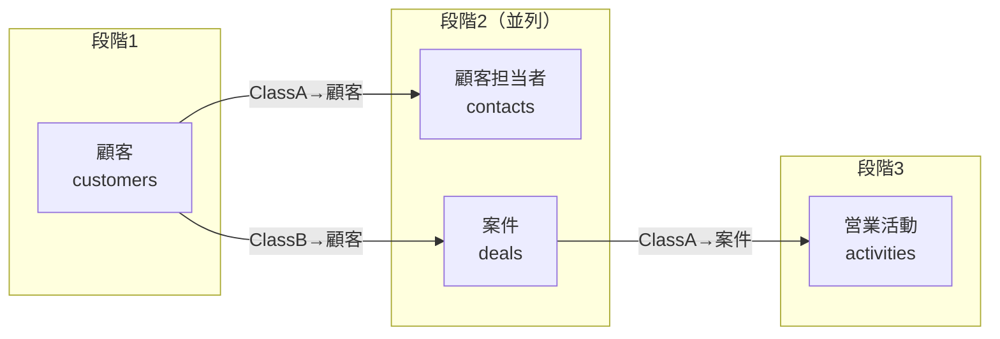

# 06 高速化の工夫

> この資料は、筆者が個人で作成した非公式のメモです（多くを AI が書いています）。プリザンターの正確な仕様は公式マニュアル（原稿: https://github.com/Implem/Implem.Pleasanter.Manual ）を参照してください。

時間を短くするために、次の3つを行った。

1. API の呼び出し回数を減らす（BulkUpsert）
2. 待ち時間を重ねる（依存段階ごとの並列登録、env 取得と設計の並行）
3. 調べ物を減らす（調査結果の文書化、見本の用意）

## 6.1 BulkUpsert による一括投入

最初の登録では、レコードを1件ずつ Create で登録していた（3テーブル × 100件 = 300回の呼び出し）。

BulkUpsert は1回の呼び出しで複数件を登録できる。`Keys` を省略すると全件が新規作成になる（マニュアルで確認し、実地でも確認した）。register.py では500件ずつに分けて送る（`CHUNK = 500`）。100件のテーブルなら1回で済む。

| 項目 | 個別 Create | BulkUpsert |
|---|---|---|
| 3テーブル × 100件の呼び出し回数 | 300回 | 3回 |
| 計算式（Formulas） | 動く | 動く（実地確認） |
| 集計（Summaries） | 1件ごとに動く | 全件処理後にまとめて同期される（api.md）。register.py は最後に SynchronizeSummaries も呼ぶ |
| 新しい ResultId | レスポンスで分かる | 返らない → 投入後に Get で対応表を作る |
| 「インポート後」通知 | — | AfterImport が null でも送られる → false を明示 |

BulkUpsert の注意点（`reference\api.md` より）:

- レコード単位で順に処理され、エラーが出た時点で止まる。それより前の件は確定していて、ロールバックされない。
- 同じテーブルで別の一括処理が実行中だと 429 が返る。
- 件数の上限は `General.json` の `BulkUpsertMax`（ソース上の既定は 0 = 無制限）。

register.py は失敗したらフォルダごと削除するので、途中まで入ったデータが残ることはない（08章）。

## 6.2 依存段階ごとの並列登録

リンク先のテーブルを先に登録しないと、リンク列に入れる ResultId が決まらない。build.py はリンクの依存関係からテーブルを段階に分け、同じ段階のテーブルは並列に登録する（`ThreadPoolExecutor`、最大8並列）。



段階分けのアルゴリズム（`build.levels`）は単純で、「依存先がすべて登録済みのテーブル」を1段階として取り出すことを繰り返す。どのテーブルも取り出せなくなったら、リンクが循環しているので SpecError を出す。

```python
ready = [k for k, t in remaining.items() if all(d in done for d in dependencies(t))]
if not ready:
    raise SpecError('テーブル間のリンクが循環しています: ' + ', '.join(remaining))
```

作成したアプリの登録順は次のとおり。

| アプリ | 登録順 |
|---|---|
| IT資産管理 | [assets, licenses] → [repairs] |
| 図書貸出管理 | [books, requests] → [loans] |
| SaaS営業 顧客・案件管理 | [customers] → [contacts, deals] → [activities] |

段階内の並列のほか、次の処理も並列にしている。

- 各テーブルの UpdateSite（作成直後と、通知・リマインダーの有効化）
- リンク先テーブルの Get（キー列 → ResultId の対応表）
- SynchronizeSummaries
- 検証時の全テーブルの Get

テーブルの作成（CreateSite）だけは直列にしている。メニューの並び順を spec の順にするためで、1件あたり約0.1秒である。

## 6.3 Claude 側の時間を減らす

API の処理時間（数秒）よりも、Claude が調べたり書いたりする時間のほうが長い。そこで次のようにした。

| 工夫 | 内容 |
|---|---|
| 調べ直さない | SKILL.md の「前提（調べ直さない）」と reference に確認済みの事実を置いた。ソースやマニュアルは「spec にない設定を使うときだけ」引く |
| 確認しない | SKILL.md に「設計方針の確認はしない。既定値と設計ガイドで決めて進め、最後の報告でまとめて伝える」と書いた |
| 見本から書く | `examples\it-assets\` の spec.json と gen_rows.py を雛形にする |
| 並行して進める | env.py をバックグラウンドで実行しながら設計する。spec と gen_rows.py は同時に書いてよい |
| 分担する | テーブルが4つ以上でデータ生成が重いときは、テーブルごとにサブエージェントに rows を書かせてよい |
| エラー文で直す | build.py / register.py のエラー文に直す場所（テーブル key、行番号、列名）を出す。SKILL.md に「推測で直さず、エラー文を読む」と書いた |

## 6.4 計測値

`output\*\result.json` の `seconds` と `total_seconds`（register.py の処理時間、単位: 秒）。

| アプリ | テーブル × 件数 | サイト作成 | データ投入 | 通知・集計 | 検証 | 合計 |
|---|---|---|---|---|---|---|
| IT資産管理（回帰テスト） | 3 × 100 | 0.9 | 3.0 | 0.3 | 0.4 | **4.7** |
| 図書貸出管理（使い勝手テスト） | 3 × 100 | 1.1 | 4.9 | 0.5 | 0.5 | **7.1** |
| SaaS営業 顧客・案件管理（中心の検証アプリ） | 4 × 100 | 1.0 | 5.9 | 0.6 | 0.4 | **7.9** |
| zz_動作確認（計算式・平均集計の確認用） | 1 × 3 | 0.5 | 0.3 | 0.1 | 0.1 | 1.0 |

「データ投入」には、ユーザー・部署の再取得、BulkUpsert、キー対応表のための Get が含まれる。SaaS営業は依存段階が3つあるので、段階が2つの IT資産管理より時間がかかっている。

IT資産管理の回帰テストでは、env 取得 → データ生成 → build 検査 → 登録・検証の全体が約7秒だった（`output\IT資産管理\run.log` の `real 0m6.966s`）。

### Before / After

| 項目 | 最初の登録（個別 Create） | 仕組み化後（IT資産管理） |
|---|---|---|
| データ投入の API 呼び出し | 300回 | BulkUpsert 3回 ＋ リンク先（資産台帳）の Get 1回 |
| 登録処理の時間 | 記録なし | 4.7秒 |
| パイプライン全体（env〜検証） | 記録なし | 約7秒 |

最初の登録の所要時間は記録が残っていないので、この資料では比較していない。

### 指示から完成までの時間

| アプリ | 指示から完成まで | 備考 |
|---|---|---|
| 図書貸出管理 | 約2分5秒 | 事情を知らないサブエージェントが CLAUDE.md と SKILL.md だけで作成。エラー0 |
| SaaS営業 顧客・案件管理 | 約2分 | メインからスキル経由で作成。4テーブル |

どちらも、時間の大部分は Claude が spec と gen_rows.py を書く時間であり、スクリプトの処理は8秒以内に収まっている。

> **プリザンターの性質との関係**: 最大の短縮（300回の Create → 1テーブル1回の BulkUpsert）は、公開されているマニュアルの原稿を AI が読んで見つけたものである。BulkUpsert で計算式・Summary が動くことや、通知の AfterImport の扱いは、公開されている本体のソースで確かめられた。
