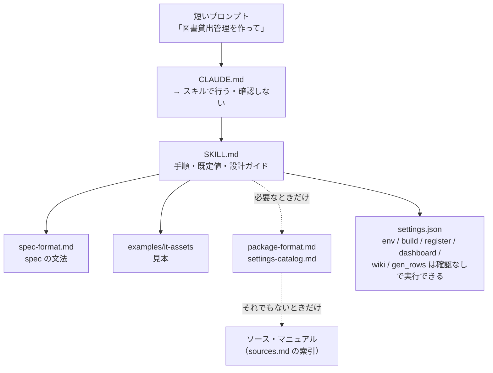
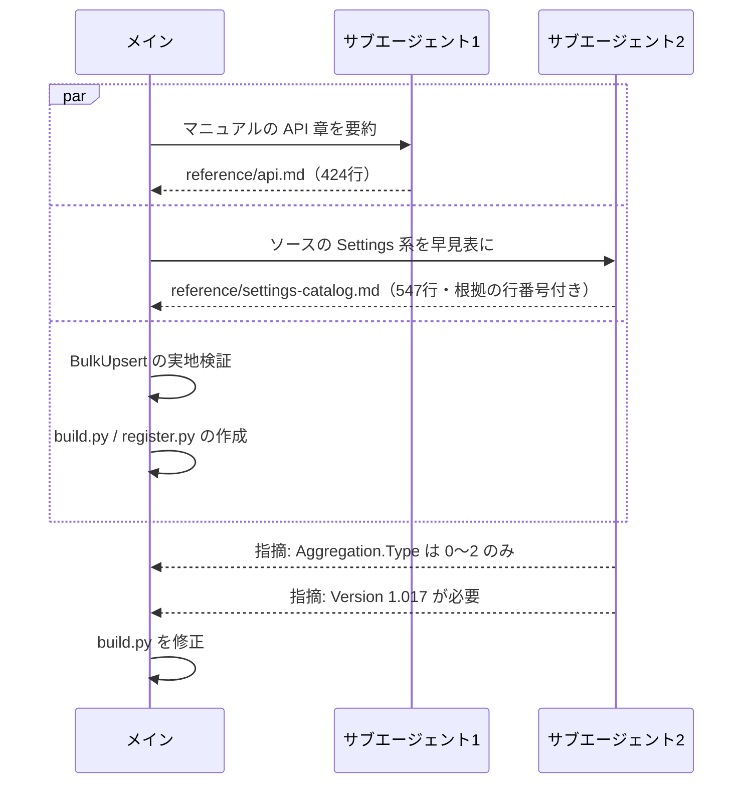

# 07 Claude Code の構成

> この資料は、筆者が個人で作成した非公式のメモです（多くを AI が書いています）。プリザンターの正確な仕様は公式マニュアル（原稿: https://github.com/Implem/Implem.Pleasanter.Manual ）を参照してください。

## 7.1 3つのファイルの役割分担

| ファイル | 読まれるタイミング | 書いてあること | 書いていないこと |
|---|---|---|---|
| `CLAUDE.md`（19行） | プロジェクトで作業するとき常に | 「アプリの作成・削除・作り直しはスキルで行う」「アプリ名だけなら確認せず既定値で進める」、secret.txt の扱い、作業フォルダ、Python の実行方法、削除のルール、参照先 | 手順の詳細、設計方針 |
| `SKILL.md`（63行） | 「〜アプリを作って」などの依頼でスキルが選ばれたとき | 引数と既定値、6段階の手順、削除・作り直し、設計ガイド、時間をかけないための注意 | spec の文法、プリザンターの仕様 |
| `reference\*.md` | spec を書くとき、spec にない設定を使うとき | spec の文法（spec-format）、確認済みの事実（package-format）、API（api）、SiteSettings（settings-catalog）、調べ物の索引（sources） | — |
| `.claude\settings.json` | ツールを実行するとき | 確認なしで実行してよいコマンドとファイル操作 | 削除系のコマンド |



知識を3層に分けて、上の層ほど短くしている。必要になるまで下の層は読まない。

## 7.2 短いプロンプトで動く理由

| 普通なら指示に書くこと | どこに書いてあるか |
|---|---|
| 接続先と API キーの場所、キーを出さないこと | CLAUDE.md、SKILL.md「前提」 |
| テーブル数・件数・通知の有無 | SKILL.md の既定値（各100件 / 2〜4テーブル / 通知・リマインダーあり / 登録まで実行 / トップ直下） |
| どんなテーブル・列を作るか | SKILL.md の設計ガイド（台帳1つ ＋ 履歴・明細1〜2つ ＋ 必要ならマスタ、列は10〜18程度、など） |
| データの分布 | 設計ガイド（未完了を10〜20%、直近30日以内の日付で。例外データを数件混ぜる。今日を基準にする） |
| ユーザー・部署 | `output\env.json` の実在値を使う。UserId 1〜2 の管理者は避ける |
| 作業の進め方 | 「設計方針の確認はしない」「env.py は設計と並行」「失敗したらエラー文を読む」 |
| 失敗時・作り直し | 自動削除、`delete.py` → 手順5 |

引数で既定値を変えられる: `<アプリ名> [件数N] [通知なし] [登録しない] [を削除]`

## 7.3 settings.json の許可リスト

```json
"allow": [
  "Bash(PYTHONUTF8=1 python -P .claude/skills/pleasanter-app/scripts/env.py:*)",
  "Bash(PYTHONUTF8=1 python -P .claude/skills/pleasanter-app/scripts/build.py:*)",
  "Bash(PYTHONUTF8=1 python -P .claude/skills/pleasanter-app/scripts/register.py:*)",
  "Bash(PYTHONUTF8=1 python -P .claude/skills/pleasanter-app/scripts/wiki.py:*)",
  "Bash(PYTHONUTF8=1 python -P .claude/skills/pleasanter-app/scripts/dashboard.py:*)",
  "Bash(PYTHONUTF8=1 python -P output/*/gen_rows.py:*)",
  "Read(./output/**)", "Edit(./output/**)", "Write(./output/**)"
]
```

- 作成の流れで使うスクリプト（env / build / register / dashboard / wiki / gen_rows）は確認なしで実行できる。
- `delete.py` は許可リストに入れていない。削除は毎回、利用者の確認を経る（08章）。
- ファイルの読み書きは `output\` 配下に限っている。

## 7.4 サブエージェントによる並列作業

### 知識の抽出（段階6）



調べ物を任せている間に、メインは検証とスクリプト作成を進めた。サブエージェントの成果物を読む中で、メインのスクリプトにあった誤り2つが見つかった。

| 誤りの箇所 | 正しい仕様と影響 | 修正 |
|---|---|---|
| Aggregation.Type | 0〜2（Count / Total / Average）の3種しかない。誤った値を書くと SiteSettings 全体のデシリアライズが失敗して null になる | build.py で `count/total/average` → 0/1/2 に変換し、それ以外は SpecError |
| SiteSettings.Version | `1.017` を指定しないと読み込み時に移行処理が走る | build.py と dashboard.py で `Version: 1.017` を常に出力 |

### 使い勝手テスト（段階9）

事情を何も知らないサブエージェントに、CLAUDE.md と SKILL.md だけを渡して「図書貸出管理」を作らせた。

| 項目 | 結果 |
|---|---|
| 所要時間 | 約2分5秒 |
| エラー | 0 |
| ソース・マニュアルの参照 | なし |
| 成果物 | 3テーブル（蔵書台帳 / 貸出記録 / 購入リクエスト）× 100件、登録処理 7.1秒 |

## 7.5 フィードバックループ


使い勝手テストで出た指摘4点と、その反映先は次のとおり。

| # | 指摘 | 反映 |
|---|---|---|
| 1 | settings-catalog.md が未完成だった | 完成させた（547行） |
| 2 | summary の Count で source を省略できるか分からない | spec-format.md に「Count のときは `source` 不要」と明記 |
| 3 | formula の演算子が分からない | spec-format.md に「演算子は `+ - * /`、左から順に計算（優先順位なし）。数値リテラル可」と明記 |
| 4 | 未完了データが少なすぎた | SKILL.md の設計ガイドに「未完了は各表の10〜20%を、直近（概ね30日以内）の日付で必ず作る」を追加 |

指摘4の背景: 日付を一様に散らすと、未完了のデータが数件しかできず、「未完了」ビューや通知・リマインダーの動作を確認できない。例えば指摘前に作った IT資産管理の修理・保守履歴は、未完了（受付・対応中・部品待ち）が100件中7件だった。

あわせて、検証の抜けも直した（Average / Min / Max の集計値、計算式の値の照合）。詳しくは08章。

## 7.6 構成の要点

- CLAUDE.md は「どのスキルを使うか」と「守るべきルール」だけにして短く保つ。
- 手順と既定値はスキルに、仕様の事実は reference に置き、必要になったときだけ読む。
- 調べて分かったことは reference に追記するルールにして、次回の調査を減らす。
- ドキュメントの良し悪しは、事情を知らないエージェントに実際に使わせて確かめる。

> **プリザンターの性質との関係**: reference の大部分は、公開されているマニュアルの原稿と本体のソースを AI が読んで作った（api.md 424行、settings-catalog.md 547行、根拠の行番号付き）。一次情報から作った知識なので、事情を知らないエージェントがそれだけを頼りにエラー0でアプリを作れた。
