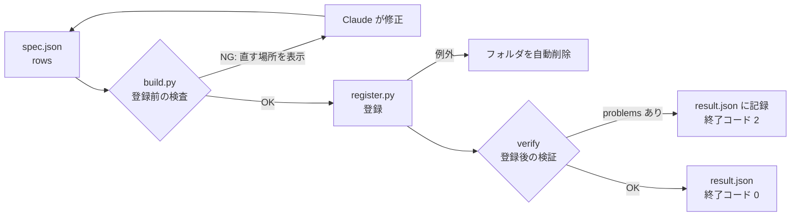
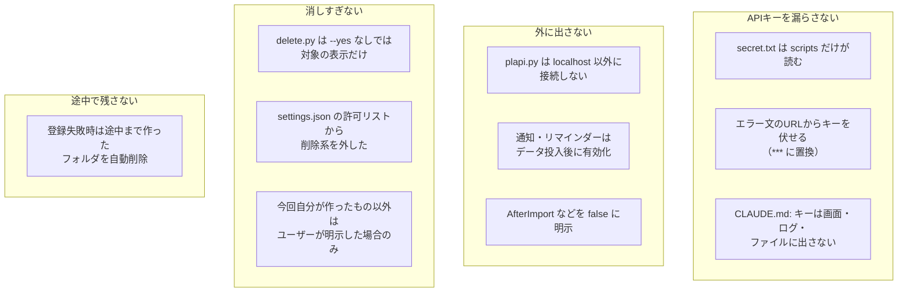

# 08 品質と安全

> この資料は、筆者が個人で作成した非公式のメモです（多くを AI が書いています）。プリザンターの正確な仕様は公式マニュアル（原稿: https://github.com/Implem/Implem.Pleasanter.Manual ）を参照してください。

## 8.1 品質を保つ3つの関門



## 8.2 build.py の検査項目

登録の前に、spec と rows の誤りを見つける。エラー文には、直す場所（テーブル key、行番号、列名）を入れている。

| 対象 | 検査内容 | エラー文の例 |
|---|---|---|
| テーブル | key の重複 | `テーブルの key が重複しています` |
| 列定義 | 列名が `Title` `Body` `Status` `Manager` `Owner` や `ClassA`〜 などの規則に合うか、重複がないか | `assets: 列名が不正です: ClassAA` |
| リンク | リンク先テーブルが存在するか | `repairs.ClassA: リンク先テーブルがありません: asset` |
| リンク | テーブル間のリンクが循環していないか | `テーブル間のリンクが循環しています: ...` |
| リンク | リンク先に keyColumn があるか | `assets: repairs.ClassA から参照されるので keyColumn が必要です` |
| ビュー | 通知・リマインダー・集計で指定したビュー名が存在するか | `deals.notifications: ビューがありません: 受注済` |
| 集計 | Summary の集計先が存在し、link がその集計先へのリンク列か | `... ClassB は customers へのリンク列ではありません` |
| 集計 | Aggregation の type が count / total / average か | `type は count/total/average のみです: max` |
| 計算式 | 式を解釈できるか、演算子が `+ - * /` か | `計算式の演算子が不正です: NumA % NumB` |
| rows | spec にない列がないか | `deals 行12: spec にない列があります: ['NumG']` |
| rows | キー列の空・重複 | `assets: キー列 ClassA の値が重複しています` |
| rows | 状況（Status）の値が定義済みか | `未定義の状況の値があります: {300}` |
| rows | 選択肢列の値が選択肢にあるか（複数選択の列は除く） | `deals.ClassD: 選択肢にない値があります: ['Pro']` |
| rows | リンク列の値がリンク先のキー列に存在するか | `repairs.ClassA: assets に存在しないキーを参照しています: ['NPC-0999']` |

（エラー文の例は、build.py の書式に値を当てはめたもの）

検査に通ると、テーブルごとの件数と登録順を表示する。

```text
OK assets: 資産台帳 100件
OK repairs: 修理・保守履歴 100件
OK licenses: ソフトウェアライセンス台帳 100件
登録順: [assets, licenses] → [repairs]
```

ユーザー・部署の名前が env.json に見つからない場合はエラーではなく警告にしている（`Resolver.warnings`）。警告は result.json の `warnings` に残る。作成時に作った4つのアプリはどれも警告0件だった。

## 8.3 register.py の自動検証

登録後、全テーブルを Get し直して、次の項目を照合する。

| 項目 | 照合の方法 |
|---|---|
| 件数 | 登録後の件数と rows の件数が一致するか |
| リンク | リンク列の値がリンク先の実在 ResultId になっている件数と、rows でリンク列が空でない件数が一致するか |
| 集計（Summary） | 子のデータから Count / Total / Average / Min / Max を計算し、親の書き込み先の値と比べる |
| 計算式 | 左から順の四則演算として期待値を計算し、登録値と比べる（0除算は照合しない） |
| 設定の反映 | GetSite で Views / Notifications / Reminders / Summaries / Formulas / Links の件数が送った設定と一致するか |

不一致があれば `result.json` の `problems` に1行ずつ記録し、終了コード 2 で終わる。SKILL.md には「検証 NG があれば内容をそのまま伝える」と書いてある。

**ビュー条件付きの Summary**（`sourceView` を指定したもの）は、register.py の自動照合では値を比べていない。コードには「ビュー条件付きの集計はここでは再現できないので値の照合をしない」とコメントがある（設定が反映されたかどうかは、上の「設定の反映」で確かめている）。検証アプリの SaaS営業アプリでは、ビュー条件付きの Summary 3本を別途照合し、すべて一致した。

最初のパッケージ作成のときは、生成スクリプトの中で次の整合性も検査していた。

- ID が一意か
- 「修理中」の資産の件数と、未完了の修理の件数が一致するか（IT資産管理の rows では、資産の修理中7件・修理の未完了7件）
- 修理費の合計と、資産側の Summary（修理費合計）の値が一致するか

## 8.4 安全策



| 対策 | 実装 | 防ぐもの |
|---|---|---|
| 接続先を localhost に限る | `plapi.Client.__init__` で URL が `http://localhost` / `https://localhost` / `http://127.0.0.1` で始まらなければ例外 | 誤った設定による社外サーバへの送信 |
| API キーを出さない | キーは `self._key` に保持し、表示しない。HTTP エラー時のメッセージでは URL 中のキーを `***` に置換 | 画面・ログ・会話履歴への漏えい |
| 通知を後から入れる | 作成直後と投入中は `without_alerts` で Notifications / Reminders を外す。全データ投入後の UpdateSite で入れる | テストデータ投入による大量のメール送信 |
| 通知の条件を明示 | build.py が `AfterDelete` / `AfterCopy` / `AfterBulkUpdate` / `AfterBulkDelete` / `AfterImport` を false で出力 | null が true 扱いになることによる意図しない送信 |
| 削除は2段階 | `delete.py` は GetSite で対象のタイトル・SiteId・種類・親・更新日時を表示する。フォルダなら「配下もまとめて削除」と表示。`--yes` を付けたときだけ DeleteSite | 取り違えによる削除 |
| 削除は許可リスト外 | settings.json に delete.py を入れていない | 確認なしの削除 |
| 失敗時の後始末 | register.py は例外時に作成済みのフォルダを DeleteSite（`--keep-on-fail` で残せる） | 中途半端なアプリの残留 |
| AI 用キーを残さない | spec・テンプレートにはプレースホルダ `__API_KEY__` だけを書き、register.py の `with_secrets()` が UpdateSite の送信直前に `secret.txt` の `ClaudeApiKey` で置換する（12章） | spec・package・result・ログへのキーの混入 |
| テストデータの個人情報 | 設計ガイドで「実在人物の住所・電話などは作らない。Faker のダミー値は可」 | 実在の個人情報の混入 |

### 実例: 自動モードの安全判定で削除が止まった

作業の途中で、テストサイトの削除が Claude Code の自動モードの安全判定で拒否された。このとき、別の方法で削除を回避することはせず、利用者に判断を委ねた。

削除は取り消しにくい操作である。スクリプト側（`--yes`、対象の表示）、権限設定（許可リストから除外）、実行環境（安全判定）の3か所で止められる構成になっており、どれか1か所で止まれば、利用者の判断を待つ。

> **プリザンターの性質との関係**: プリザンターはセルフホストできるので、接続先を localhost に限るという単純な規則で、テストデータの登録を自社環境の中に閉じられた。外部に出るのは、12章の AI機能が明示的に呼ぶ AI API だけである。
