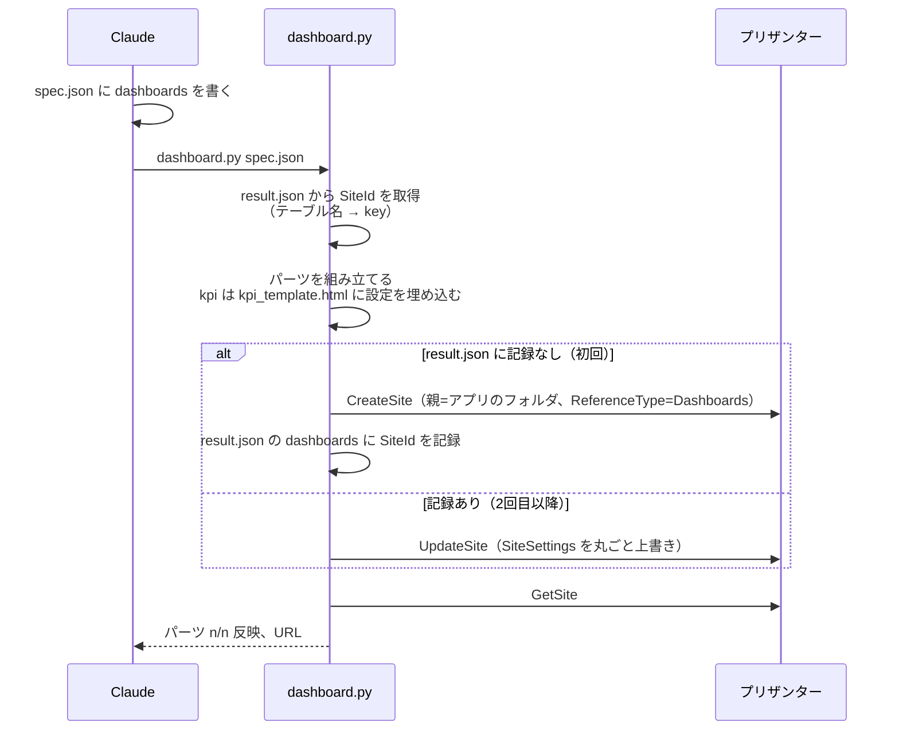
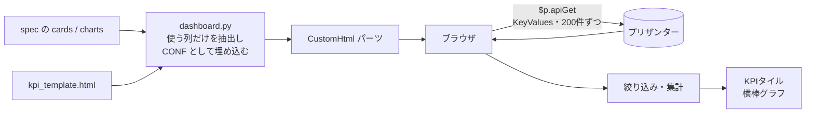
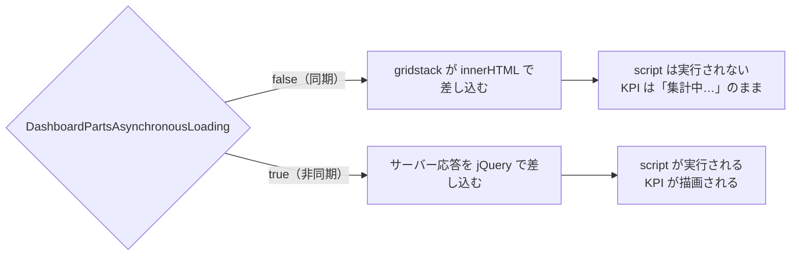

# 09 ダッシュボード

> この資料は、筆者が個人で作成した非公式のメモです（多くを AI が書いています）。プリザンターの正確な仕様は公式マニュアル（原稿: https://github.com/Implem/Implem.Pleasanter.Manual ）を参照してください。

> この章では、ダッシュボードの仕組みと spec の書き方、KPI の検証結果をまとめる。ブラウザでの表示は、まだ人が確認していない（8.6）。

## 9.1 プリザンターのダッシュボードの仕組み

- ダッシュボードは `ReferenceType=Dashboards` のサイトである。テーブルと同じく CreateSite / UpdateSite で作れる。
- 中身は SiteSettings の `DashboardParts`（パーツの配列）で、パーツは7種類ある。
- レイアウトは gridstack で、横20列、1単位16px。各パーツは `X` / `Y` / `Width` / `Height` を持つ。

| Type | 名前 | 内容 | spec の type |
|---|---|---|---|
| 0 | QuickAccess | サイトへのリンク集 | `quickaccess` |
| 1 | TimeLine | 複数テーブルの更新を時系列で表示 | `timeline` |
| 2 | Custom | 任意のテキスト・HTML（Content） | `custom` |
| 3 | CustomHtml | 任意の HTML・スクリプト（HtmlContent） | `html`、`kpi` |
| 4 | Calendar | カレンダー | `calendar` |
| 5 | Kamban | カンバン | `kamban` |
| 6 | Index | 一覧 | `index` |

`kpi` は独自の type で、CustomHtml（Type=3）に KPI テンプレートを埋め込んだものである。

## 9.2 作成・更新の流れ



- 登録済みのアプリが前提で、`result.json` の `sites` からテーブルの SiteId を引く。
- 2回目以降は UpdateSite で上書きするので、ダッシュボードを作り直す必要がない。spec を直して再実行するだけでよい。
- `--only <ダッシュボード名>` で1つだけ更新できる。
- 反映の確認として、GetSite で `DashboardParts` の数が送った数と一致するかを見る。一致しなければ `NG: パーツが反映されていません` と表示する。

## 9.3 spec の書き方

spec.json の最上位に `dashboards` を書く。以下は検証アプリの SaaS営業アプリの spec.json（`営業ダッシュボード`）からの抜粋である。

```json
"dashboards": [{
  "title": "営業ダッシュボード",
  "parts": [
    {"type": "quickaccess", "title": "メニュー", "showTitle": false, "h": 5,
     "tables": ["customers", "deals", "activities", "contacts"]},
    {"type": "kpi", "title": "営業KPI", "h": 36,
     "cards": [
       {"label": "加重パイプライン", "table": "deals", "agg": "sum", "column": "NumC", "weight": "NumE",
        "filter": {"Status": [100, 200, 300, 400, 500]}, "format": "man", "note": "MRR × 受注確度"},
       {"label": "受注率", "table": "deals", "agg": "count", "filter": {"Status": [900]},
        "ratioOf": {"agg": "count", "filter": {"Status": [900, 910]}}, "format": "pct"},
       {"label": "予定日超過", "table": "deals", "agg": "count",
        "filter": {"Status": [100, 200, 300, 400, 500], "DateB": "overdue"}, "format": "num"}
     ],
     "charts": [
       {"title": "フェーズ別パイプライン（MRR）", "table": "deals", "groupBy": "Status", "agg": "sum",
        "column": "NumC", "filter": {"Status": [100, 200, 300, 400, 500]}, "format": "man", "order": "key"}
     ]},
    {"type": "index", "title": "進行中の案件（受注予定日が近い順）", "table": "deals", "w": 12, "h": 24,
     "filter": {"Status": [100, 200, 300, 400, 500]}, "sort": {"DateB": "asc"}},
    {"type": "timeline", "title": "最近の更新", "tables": ["deals", "activities"], "x": 12, "w": 8, "h": 24},
    {"type": "kamban", "title": "パイプライン", "table": "deals", "h": 26, "x_by": "Status", "y_by": "Owner",
     "aggregate": "Total", "value": "NumC", "aggregationView": true},
    {"type": "calendar", "title": "営業活動カレンダー", "table": "activities", "h": 34, "fromTo": "DateA"}
  ]
}]
```

実際の spec では、パーツは6個（クイックアクセス / KPI / 一覧 / タイムライン / カンバン / カレンダー）、KPI のタイルは8枚、グラフは4本ある。上ではタイル3枚とグラフ1本だけを載せ、一部のキーを省いた。

### パーツ共通

| キー | 既定値 | 内容 |
|---|---|---|
| `type` | — | 9.1 の表の spec の type |
| `title` / `showTitle` | `""` / true | パーツの見出し |
| `x` / `y` / `w` / `h` | 0 / 自動 / 20 / 20 | 位置と大きさ（グリッドの単位）。`y` を省略したとき、`x` が 0 なら次の行に、`x` が 0 より大きければ直前のパーツと同じ行に置く |
| `table` / `tables` | — | 対象テーブルの key（複数なら `tables`） |
| `css` | — | パーツに付ける CSS クラス（ExtendedCss） |
| `filter` / `sort` / `grid` | — | パーツのビュー（timeline / calendar / kamban / index）。書き方はテーブルのビューと同じ |

### type ごとの主なキー

| type | キー |
|---|---|
| quickaccess | `tables`（省略時は全テーブル）、`vertical` |
| timeline | `titleTemplate`（既定 `[Title]`）、`bodyTemplate`（既定 `[Body]`）、`count`（既定10）、`display`（simple / standard / detailed） |
| calendar | `fromTo`（既定 DateA）、`period`（既定 Monthly）、`full`（既定 true）、`groupBy`、`showStatus` |
| kamban | `x_by`（既定 Status）、`y_by`、`aggregate`（既定 Count）、`value`（既定 NumA）、`aggregationView`、`showStatus` |
| index | `tables`、`filter`、`sort`、`grid` |
| custom / html | `content` / `html` |
| kpi | `cards`、`charts`（8.4） |

ダッシュボード全体の `async`（既定 true）は `DashboardPartsAsynchronousLoading` になる。kpi パーツがあるときは常に true にする（理由は 8.5）。

## 9.4 KPI テンプレート（kpi_template.html）

### 仕組み



- dashboard.py は、cards / charts で使う列（`column` / `weight` / `groupBy` / `filter` の列 ＋ ResultId）だけを集め、テーブルの SiteId と一緒に設定（CONF）としてテンプレートに埋め込む。
- ブラウザ側では `$p.apiGet` で、`ApiDataType: 'KeyValues'`・`ApiColumnKeyDisplayType: 'ColumnName'` の形式でデータを取得する。200件ずつのページングを `TotalCount` まで辿る。
- 値（`Value`）と表示名（`Text`）の2回取得して合成する。集計は値で行い、グラフの項目名には表示名を使う（例: Owner は値で分類し、ユーザー名で表示する）。
- API は閲覧しているユーザーの権限で呼ばれる。取得できなければ「データを取得できませんでした（閲覧権限を確認してください）」と表示する。

### cards（KPIタイル）と charts（横棒グラフ）

| キー | 内容 |
|---|---|
| `table` | 対象テーブルの key |
| `agg` | `count`（件数）/ `avg`（平均）/ それ以外は合計 |
| `column` | 集計する数値列 |
| `weight` | 重みの列。`column × weight / 100` で集計する（例: MRR × 受注確度%） |
| `filter` | 絞り込み。配列ならいずれかに一致、日付の指定（下表）、それ以外は完全一致 |
| `format` | `yen`（¥区切り）/ `man`（万円、小数1桁）/ `pct`（%表示）/ それ以外（`num` など）や省略時は数値 |
| `label` / `note` | タイルの見出しと補足（cards） |
| `ratioOf` | 分母の条件。`値 ÷ ratioOf の集計値` を表示する（cards。率の KPI 用） |
| `title` / `groupBy` / `top` / `order` | グラフの見出し、分類する列、表示件数（既定10）、`key` なら分類の値の順（既定は値の大きい順）（charts） |

日付の絞り込みには `thisMonth` / `lastMonth` / `thisYear`、`overdue`（昨日以前。未入力は除く）、`next:N`（今日から N 日後まで）、`past:N`（N 日前から今日まで）を書ける。

### 描画の方針

- 外部ライブラリは使わない。HTML と CSS の横棒だけで描く。
- グラフは単一系列の横棒で、色は1色（ライト `#2a78d6`、ダーク `#3987e5`。`prefers-color-scheme` で切り替え）。
- 行にマウスを載せると、背景が変わり、`項目名：値` がツールチップで表示される。
- 値は桁区切りで表示し、表示前に HTML をエスケープする。
- パーツ ID ごとに要素 ID（`pkpi-<パーツID>`）を分けているので、1つのダッシュボードに複数の kpi パーツを置ける。

## 9.5 重要な発見: CustomHtml のスクリプトは非同期読み込みのときだけ動く

CustomHtml パーツに書いた `<script>` は、**非同期読み込みのときだけ実行される**。同期読み込みでは、gridstack がパーツの HTML を `innerHTML` で差し込むため、ブラウザの仕様でスクリプトが実行されない。非同期読み込みでは、サーバーの応答を jQuery で差し込む（`DashboardUtilities.cs:1450` の ReplaceAll）ので、スクリプトが動く。



dashboard.py は、kpi パーツが1つでもあれば `async` を true に固定する。エラーが出ずに何も表示されないだけの不具合なので、画面を見る前にソースで原因を確定できたことが大きい。

## 9.6 KPI の検証

ブラウザを使わずに、テンプレートのスクリプトを node で実行して集計値を確かめた。

1. 実 API の応答（KeyValues 形式の Value と Text）を、Python で事前に取得して保存する。
2. node で `$p.apiGet` をモックし、保存した応答を返すようにして、kpi_template.html のスクリプトを実行する。
3. 描画された KPI の値を、事前に Python で照合した値と比べる。

結果は、事前のデータ照合とすべて一致した。

| KPI | 値 |
|---|---|
| 契約MRR | 3,932.5万円 |
| 契約中の顧客 | 36社 |
| パイプライン（MRR） | 2,309.2万円 |
| 加重パイプライン | 1,234.6万円 |
| 今月の受注MRR | 298.8万円 |
| 受注率 | 69.2%（45 / 65） |
| 14日以内に受注予定 | 10件 |
| 予定日超過 | 7件 |

rows とも矛盾しない。顧客の「契約中」は36件、案件の受注は45件、失注は20件である（9.3）。

**ブラウザでの表示は、まだ人が確認していない。** レイアウト、色、ホバー時の表示、権限による取得の可否は未確認である。

## 9.7 実績

| ダッシュボード | パーツ数 | SiteId | 備考 |
|---|---|---|---|
| 営業ダッシュボード（SaaS営業 顧客・案件管理） | 6 | 48492 | KPI タイル8枚・グラフ4本。集計値は node で検証済み、ブラウザでの表示は未確認 |

> **プリザンターの性質との関係**: ダッシュボードの設定も SiteSettings の JSON（DashboardParts）なので、spec から生成して UpdateSite で何度でも上書きできる。スクリプトが動く条件（非同期読み込みのときだけ）は、公開されているソースを読んで確定できた。
