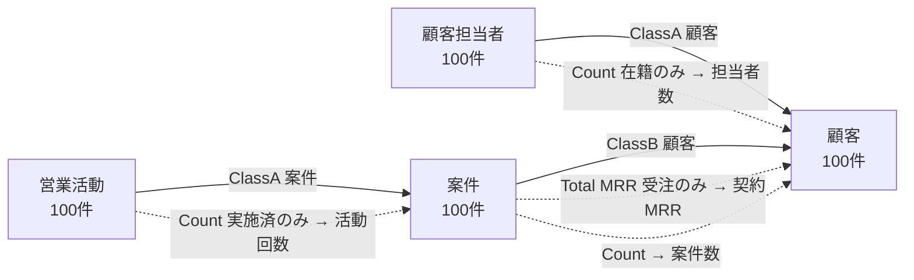

# 10 実績

> この資料は、筆者が個人で作成した非公式のメモです（多くを AI が書いています）。プリザンターの正確な仕様は公式マニュアル（原稿: https://github.com/Implem/Implem.Pleasanter.Manual ）を参照してください。

## 10.1 作成したアプリの一覧

数値は作成時の `output\<アプリ名>\spec.json` と `result.json` による（筆者の検証環境）。

| アプリ | 目的 | テーブル × 件数 | 登録処理 | 検証 |
|---|---|---|---|---|
| IT資産管理 | 回帰テスト（最初の依頼を spec 化） | 3 × 100 | 4.7秒 | OK（警告0・不一致0） |
| 図書貸出管理 | 使い勝手テスト（事情を知らないサブエージェントが作成） | 3 × 100 | 7.1秒 | OK（警告0・不一致0） |
| SaaS営業 顧客・案件管理 | 中心の検証アプリ | 4 × 100 | 7.9秒 | OK（警告0・不一致0） |
| zz_動作確認 | 計算式と平均の集計の動作確認 | 1 × 3 | 1.0秒 | OK |

## 10.2 機能の内訳

| アプリ | リンク | Summary | 計算式 | ビュー（うちカンバン / クロス集計 / カレンダー） | 通知 | リマインダー |
|---|---|---|---|---|---|---|
| IT資産管理 | 1 | 1 | 1 | 11（1 / 3 / 0） | 1 | 2 |
| 図書貸出管理 | 1 | 1 | 1 | 12（1 / 3 / 0） | 1 | 1 |
| SaaS営業 顧客・案件管理 | 3 | 4（うちビュー条件付き3） | 2 | 17（1 / 3 / 1） | 1 | 2 |

（ビューの数は「標準」を含む）

## 10.3 中心の検証アプリ: SaaS営業 顧客・案件管理

依頼は「BtoB向けSaaSを販売する営業の顧客・案件管理システム」。スキル経由で作成し、指示から完成まで約2分、登録処理は7.9秒だった。

実線はリンク、点線は Summary（子 → 親への集計）を表す。

| テーブル | 列 | 状況 | 主な機能 |
|---|---|---|---|
| 顧客 | 17 | 見込み / 商談中 / 契約中 / 休眠 / 解約 | 集計先（契約MRR・案件数・担当者数）、クロス集計「業種×ランク」、リマインダー「契約更新日が60日以内」 |
| 顧客担当者 | 12 | 在籍 / 異動・退職 | 顧客へリンク、Summary「在籍の担当者数」 |
| 案件 | 19 | リード / ヒアリング / 提案・デモ / 見積提示 / 交渉・稟議 / 受注 / 失注 | 計算式 MRR = ライセンス数 × 月額単価、年間契約額 = ライセンス数 × 月額単価 × 12。カンバン「パイプライン」、クロス集計「月別受注予定」、通知「受注」、リマインダー「受注予定日が14日以内」（毎日） |
| 営業活動 | 11 | 予定 / 実施済 / 中止 | 案件へリンク、Summary「実施済の活動回数」、カレンダー、クロス集計「担当者×種別」 |

- 登録順: [顧客] → [顧客担当者, 案件]（並列）→ [営業活動]
- 所要時間の内訳: サイト作成 1.0秒 / データ投入 5.9秒 / 通知・集計 0.6秒 / 検証 0.4秒
- ビュー条件付きの Summary（3本）は register.py の自動照合の対象外なので、別途照合し、すべて一致した。
- 追加で作ったもの: ダッシュボード「営業ダッシュボード」（SiteId 48492、パーツ6個）、AI機能「AI商談アシスト」（案件テーブル）、説明書 Wiki（SiteId 48493、WikiId 48494）

### データの分布（状況別の件数）

設計ガイド「未完了を10〜20%、直近の日付で」を反映した後に作ったデータである。

| テーブル | 分布 |
|---|---|
| 顧客 | 見込み 23 / 商談中 21 / 契約中 36 / 休眠 16 / 解約 4 |
| 顧客担当者 | 在籍 91 / 異動・退職 9 |
| 案件 | 進行中 35（リード 5 / ヒアリング 8 / 提案・デモ 9 / 見積提示 7 / 交渉・稟議 6）/ 受注 45 / 失注 20 |
| 営業活動 | 予定 15 / 実施済 82 / 中止 3 |

> **プリザンターの性質との関係**: 4テーブル・ダッシュボード・AI機能・説明書までを、すべて自社環境（localhost）の REST API だけで作った。
