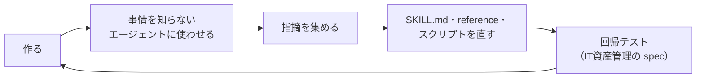
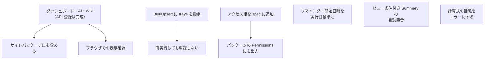

# 11 振り返りと今後

> この資料は、筆者が個人で作成した非公式のメモです（多くを AI が書いています）。プリザンターの正確な仕様は公式マニュアル（原稿: https://github.com/Implem/Implem.Pleasanter.Manual ）を参照してください。

## 11.1 うまくいったこと

| 項目 | 結果 | 効いた工夫 |
|---|---|---|
| 短い指示でアプリができる | 事情を知らないサブエージェントが約2分5秒、中心の検証アプリは約2分で完成 | 既定値と設計ガイドを SKILL.md に書き、「確認しない」と明記した |
| 処理が速い | 登録処理は 4.7〜7.9 秒（3〜4テーブル × 100件） | BulkUpsert、依存段階ごとの並列登録 |
| 間違いが少ない | 4アプリとも検証の不一致0件・警告0件 | 生成と検査をスクリプトに寄せ、エラー文に直す場所を出した |
| 調べ直さない | 使い勝手テストでソース・マニュアルの参照0回 | reference に確認済みの事実と根拠を残した |
| 知識の抽出を並列化 | api.md（424行）と settings-catalog.md（547行）を同時に作成 | サブエージェント2つに任せ、メインは検証とスクリプト作成を進めた |
| 誤りに早く気づく | Aggregation.Type と Version の誤りを修正 | サブエージェントがソースから抽出した事実と、メインの実装を突き合わせた |

## 11.2 分かったこと

- **LLM に書かせる範囲を狭くすると、速く正確になる。** spec と rows は「何を作るか」の宣言なので、プリザンター内部の ID や型を知らなくても書ける。
- **黙って失敗する設定は、スクリプトで先に止める。** SiteSettings は型を1か所間違えると全体が null になり、エラーにならない。build.py の検査で登録前に止めている。
- **ドキュメントは、事情を知らない読み手に使わせて直す。** 指摘4点（未完成の早見表、Count の source、演算子、未完了データの割合）は、書いた本人には気づきにくい。
- **テストデータは「確認したい画面」から逆算する。** 未完了が数件しかないと、ビュー・通知・リマインダーの確認ができない。

## 11.3 未対応の事項

スクリプトを読んで確認した、現時点の制約である。

### 機能の範囲

| 事項 | 現状 | 根拠 |
|---|---|---|
| ダッシュボードのサイトパッケージ出力 | 未対応。ダッシュボードは dashboard.py による API 登録だけで、`build.py --package` の出力には含まれない（説明書 Wiki も同じ） | `build_package` は Sites（フォルダ）と Results（テーブル）だけを出力 |
| AI機能のサイトパッケージ出力 | 未対応。サーバースクリプト自体はテーブルの設定に含まれるが、キーはプレースホルダ `__API_KEY__` のままなので、そのままでは AI API を呼べない | キーの差し込みは register.py の `with_secrets()` だけが行う |
| アクセス権の設定 | 未対応。パッケージでは `Permissions` が空、`IncludeSitePermission` / `IncludeRecordPermission` が false。register.py もアクセス権を設定しない | build.py `build_package`、register.py |
| 期限付きテーブル（Issues） | 未対応。テーブルは常に `ReferenceType: 'Results'` で作る（Wiki は説明書の用途だけ、wiki.py が作る） | register.py、build.py |
| プロセス・状況による制御・Lookup など | spec の専用キーはない。`settings` で SiteSettings に直接上書きすれば書ける | spec-format.md の `settings` |
| Summary の集計先の条件（DestinationCondition） | spec の専用キーはない（`sourceView` だけ） | build.py の summaries |
| リマインダーの繰り返し | `daily` / `weekly` / `monthly` の3種のみ | build.py の reminders |
| 計算式の括弧・優先順位 | 左から順に計算する。括弧は取り除かれるだけなので、`NumA * (NumB + NumC)` は `(NumA * NumB) + NumC` として計算される。エラーにはならない | build.py `parse_formula` |

### 運用面

| 事項 | 現状 | 影響と対応案 |
|---|---|---|
| リマインダーの開始日時 | 既定値が `2026-10-19T09:00:00` に固定されている | 日付が過ぎると、既定の開始日時が過去になる。実行日を基準に計算するのがよい |
| 再実行 | BulkUpsert を Keys なしで呼ぶので、register.py を再実行すると新しいフォルダにもう1セット作られる | 作り直しは「削除 → 登録」の手順（SKILL.md）。冪等にするなら keyColumn を Keys に指定する |
| ビュー条件付き Summary の検証 | register.py の自動照合の対象外（設定の反映だけを確認） | 中心の検証アプリでは別途照合した。自動化するならビューのフィルタを Python 側で再現する |
| ユーザー・部署の名前の不一致 | エラーにせず警告にして、値を空で登録する | result.json の `warnings` を必ず確認する |
| 一括投入の件数上限 | 500件ずつに分けて送る。サーバの `BulkUpsertMax` がこれより小さいと失敗する | 既定は 0（無制限）。環境に合わせて `CHUNK` を変える |
| ダッシュボードの検証 | dashboard.py はパーツの数が反映されたかだけを確認する | KPI の値は node で別途検証した（09章）。ブラウザでの表示は未確認 |
| KPI の取得量 | テーブルごとに全件を2回（値・表示名）取得してブラウザで集計する | 100件規模なら問題ないが、件数が多いと表示が遅くなる |
| AI機能のキーの置き場所 | 検証用にサイト設定のサーバースクリプトへ直書きしている | 本番では拡張サーバースクリプト（サーバー上のファイル＋`//Include:`）を推奨（12章） |

### 解消済み

| 事項 | 対応 |
|---|---|
| settings.json の許可リストに dashboard.py / wiki.py がない | 追加済み |
| spec-format.md と SKILL.md に dashboards / ai / description / usage の書き方がない | 追記済み |
| register.py 冒頭のコメントと実装の食い違い（サイト作成は直列） | コメントを「サイト作成(直列) → 設定更新(並列)」に修正済み |

## 11.4 今後の候補

| 優先 | 候補 | 理由 |
|---|---|---|
| 高 | ダッシュボードのブラウザでの表示を人が確認する | 集計値は node で検証したが、レイアウト・ホバー・権限は未確認 |
| 高 | リマインダーの開始日時を実行日基準にする | 固定値のままだと、近いうちに過去の日時になる |
| 中 | 計算式に括弧があればエラーにする | 黙って違う式になるのは、build.py の「登録前に止める」方針と合わない |
| 中 | ビュー条件付き Summary の自動照合 | 検証アプリの Summary 4本のうち3本がビュー条件付きで、手作業の照合が必要だった |
| 中 | アクセス権の設定 | 部署ごとに見せる範囲を変えるような業務アプリに必要 |
| 中 | BulkUpsert に keyColumn を Keys として指定する | 再実行で重複しないようにする |
| 低 | ダッシュボード・AI機能のサイトパッケージ出力 | API で登録できない環境に配布するときに必要 |
| 低 | 期限付きテーブル（Issues）への対応 | ガントチャート・バーンダウンを使う業務（タスク管理など）に必要 |

候補を実装したら、IT資産管理の spec で回帰テストを行い、事情を知らないサブエージェントによる使い勝手テストでドキュメントを確認する。同じ手順で進める。

> **プリザンターの性質との関係**: 未対応の事項の多くは「スクリプトの仕様を広げる」作業で済む。プリザンター側の設定はすべて JSON で表せ、ソースとマニュアルの原稿が公開されているので、次の機能を足すときも、まず一次情報を読んで仕様を確定してから実装できる。
