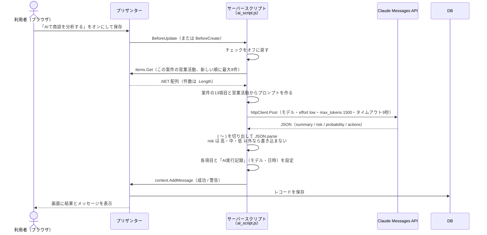
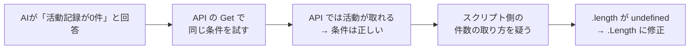

# 12 AI機能の組み込み

> この資料は、筆者が個人で作成した非公式のメモです（多くを AI が書いています）。プリザンターの正確な仕様は公式マニュアル（原稿: https://github.com/Implem/Implem.Pleasanter.Manual ）を参照してください。

## 12.1 目的

アプリを作るたびに、AI API を使う機能を1つ入れる。何を AI にさせるか（テーマ）はアプリごとに決めるが、仕組みは共通にする。spec.json に `ai` を書けば、build.py と register.py がプリザンターのサーバースクリプトとして組み込む。

このリポジトリでは例として、SaaS営業アプリの案件テーブルに「AI商談アシスト」を入れた。

## 12.2 方式の検討

| 検討した点 | 選択肢 | 判断 |
|---|---|---|
| プリザンター本体の機能を使うか | AiConnect | 使わない。AiConnect は、RAG 用にレコードを Dify / OpenAI へ同期する機能で、今回の用途（1件のレコードを読んで項目に書き戻す）とは違った |
| どこで AI API を呼ぶか | サーバースクリプト（BeforeCreate / BeforeUpdate） | 採用。保存の処理の中で呼べて、結果をそのまま項目に書き込める |
| API キーの置き場所 | ① 拡張サーバースクリプト（サーバー上のファイル＋`//Include:`）<br>② サイト設定のサーバースクリプトに直接書く | 今回は ② を採用（利用者の判断。検証用のため） |

### キーの置き場所の比較

| 方式 | キーが画面に出るか | 導入の手間 | 用途 |
|---|---|---|---|
| ① 拡張サーバースクリプト | 出ない（サーバー上のファイルにある） | ファイルを置いたあと、プリザンターの再起動が1回必要 | **本番ではこちらを推奨** |
| ② サイト設定に直書き | サイトのサーバースクリプトの本文に入る | API の UpdateSite だけで済む | このリポジトリの既定（検証用） |

② の場合、キーは SiteSettings に入る。そのため、サイトの管理画面でサーバースクリプトを開ける人には見える。画面からサイトパッケージをエクスポートしたときの扱いは確認していない。

### キーを spec やログに残さない工夫

- テンプレート（`ai_script.js`）には、キーの代わりにプレースホルダ `__API_KEY__` が書いてある。build.py が作る SiteSettings にも、プレースホルダのまま入る。
- register.py の `with_secrets()` が、UpdateSite で送る直前に `secret.txt` の `ClaudeApiKey` で置換する（`plapi.Client.secret()` で読む）。置換したものは送信にだけ使い、画面・ログ・ファイルには出さない。
- そのため、spec.json・package.json・result.json・ログには、キーが残らない。

## 12.3 仕組み

### spec の書き方（SaaS営業アプリの `ai` から抜粋）

```json
"ai": [{
  "title": "AI商談アシスト", "table": "deals",
  "trigger": {"check": "CheckA", "label": "AIで商談を分析する"},
  "model": "claude-haiku-5-5", "effort": "low", "maxTokens": 1500,
  "inputs": ["ClassA", "Title", "Status", "ClassC", "ClassD", "NumA", "NumB", "NumC", "NumE",
             "DateA", "DateB", "ClassE", "Body"],
  "related": {"table": "activities", "link": "ClassA", "sort": "DateA", "limit": 8,
              "columns": ["DateA", "ClassB", "Title", "Status", "ClassC", "ClassD", "Body"]},
  "outputs": [
    {"column": "DescriptionA", "key": "summary", "label": "AI: 状況サマリー", "instruction": "状況の要約（日本語2〜3文の文字列）"},
    {"column": "ClassG", "key": "risk", "label": "AI: 失注リスク", "allowed": ["高", "中", "低"], "instruction": "..."},
    {"column": "NumG", "key": "probability", "label": "AI: 推定受注確度", "instruction": "推定受注確度（0〜100の整数）"},
    {"column": "DescriptionB", "key": "actions", "label": "AI: 次のアクション", "instruction": "...（配列、3件以内）"}
  ],
  "stampColumn": "ClassH"
}]
```

（`system` と `instruction` は省略した）

### build.py の `apply_ai()` がすること

| 処理 | 内容 |
|---|---|
| 列の追加 | トリガーのチェック列（説明「保存時にAIを実行します（実行後は自動でオフに戻ります）」）、出力列、実行記録の列（「AI実行記録」、読み取り専用）を、spec になければ追加する |
| 選択肢 | `allowed` がある出力列は、その値を選択肢にする |
| 設定の埋め込み | 入力・関連・出力の列名と表示名、状況の値と表示名の対応、モデル・effort・max_tokens・タイムアウトを CONF にまとめ、`ai_script.js` に埋め込む |
| サーバースクリプト | `ServerScripts` に BeforeCreate / BeforeUpdate を true にして追加する（`TimeOut: 10000`） |
| 既定値 | モデル `claude-haiku-5-5`、effort `low`、max_tokens 1500、HTTP タイムアウト 9000ミリ秒 |

### 実行時の流れ



失敗したとき（タイムアウト、HTTP エラー、AI が回答を控えた、応答に本文がない、JSON を解釈できない）は、`context.AddMessage` で警告を出し、`context.Log` に記録する。レコードの保存は通常どおり行う。チェックは処理の最初にオフに戻すので、失敗してもオンのまま残らない。

## 12.4 制約と工夫

### 10秒の壁

サーバースクリプトは10秒で打ち切られる（Script.json の `ServerScriptTimeOut=10000`）。この中に AI API の往復を収めるため、次のようにした。

| 設定 | 値 | 理由 |
|---|---|---|
| モデル | `claude-haiku-5-5` | 応答が速い |
| effort | `low` | 考える量を減らして応答時間を短くする |
| max_tokens | 1500 | 出力の上限 |
| httpClient の TimeOut | 9秒 | 10秒で打ち切られる前に自分で止め、警告を出せるようにする |
| 出力形式 | 決まったキーの JSON だけ | 前置きや説明を書かせない |

実測値:

| 計測 | 時間 |
|---|---|
| Python から API を単発で呼んだとき | 1.7秒 |
| プリザンター経由の更新全体（保存〜結果の書き込み） | 4.0〜4.8秒 |

### 応答を安全に取り込む

```javascript
const raw = block.text;
const json = raw.slice(raw.indexOf('{'), raw.lastIndexOf('}') + 1);
return JSON.parse(json);
```

- 応答の前後にコードフェンスなど余計な文字が付いても解釈できるように、最初の `{` から最後の `}` までを切り出す。
- 選択肢の項目（失注リスク）は、許可した値（高・中・低）以外なら書き込まない。
- 数値の項目は `Number()` に変換する。配列は「・」付きの箇条書きにする。
- 「AI実行記録」の列に、使ったモデルと日時を残す。

### 関連テーブルを読む

`items.Get(siteId, JSON文字列)` で、この案件にリンクしている営業活動を新しい順に最大8件取得し、プロンプトに含める。第2引数は API の Get と同じ `{"View": {...}}` 形式である。

## 12.5 実装メモ: `.length` と `.Length`

`items.Get` は JavaScript の配列ではなく .NET の配列を返す。そのため、件数は `.Length` で取る。`.length` は undefined になる。

```javascript
// items.Get は .NET の配列を返すので、件数は length ではなく Length で取る
const count = rows ? (rows.Length !== undefined ? rows.Length : rows.length) : 0;
```

このバグには、AI の回答がきっかけで気づいた。



エラーにはならず、0件として処理が進んだ。AI の出力が「データがない」前提になっていたことから、問題に気づいた。

## 12.6 例: AI商談アシスト

| 項目 | 内容 |
|---|---|
| 対象 | 案件テーブル |
| トリガー | 「AIで商談を分析する」（CheckA） |
| 入力 | 案件の13項目（案件番号、案件名、フェーズ、商談種別、プラン、ライセンス数、月額単価、MRR、受注確度、商談開始日、受注予定日、競合、商談メモ）と、この案件の営業活動（最大8件） |
| 出力 | 状況サマリー（DescriptionA）、失注リスク（ClassG）、推定受注確度（NumG）、次のアクション 3件以内（DescriptionB） |

結果の例（一部を抜粋）:

> 受注予定日（2026/10/13）を過ぎても、フェーズは『リード』、確度は10のままです。…決裁者との面談はまだ設定されていません。

→ 失注リスク「高」、推定受注確度 5%

## 12.7 設定だけを更新する

```text
PYTHONUTF8=1 python -P .claude/skills/pleasanter-app/scripts/register.py <spec.json> --update-settings
```

- result.json に記録した SiteId に対して、spec から作り直した設定（列・AI・ビューなど）を UpdateSite で入れ替える。データは変えない。
- 送る直前に `with_secrets()` でキーを差し込み、そのあと通常の登録と同じ検証を行う。
- 新しいテーブルを追加した場合は、この方法では反映できない（「新規テーブルの追加は作り直しが必要」と表示して終了する）。

## 12.8 外部送信の注意

この機能は、レコードの内容を外部の AI API（`https://api.anthropic.com/v1/messages`）に送る。今回のテストデータはダミーなので問題ない。本番データで使うかどうかは、送る項目を含めて別途判断が必要である。説明書（13章）にも「実在する個人情報・機密情報は入力しないでください」と出している。

なお、データ投入中は register.py がサーバースクリプトを外しておくので、テストデータを BulkUpsert しても AI は呼ばれない。サーバースクリプトは、データ投入後の UpdateSite で通知・リマインダーと一緒に入る。

> **プリザンターの性質との関係**: サーバースクリプトの `httpClient` から外部の AI API を直接呼べるので、中継サーバーを立てずにアプリの中に AI 機能を組み込めた（1件4〜5秒）。10秒の上限と `.Length` の挙動は、公開されている本体のソースと実地確認で事前に押さえられた。
