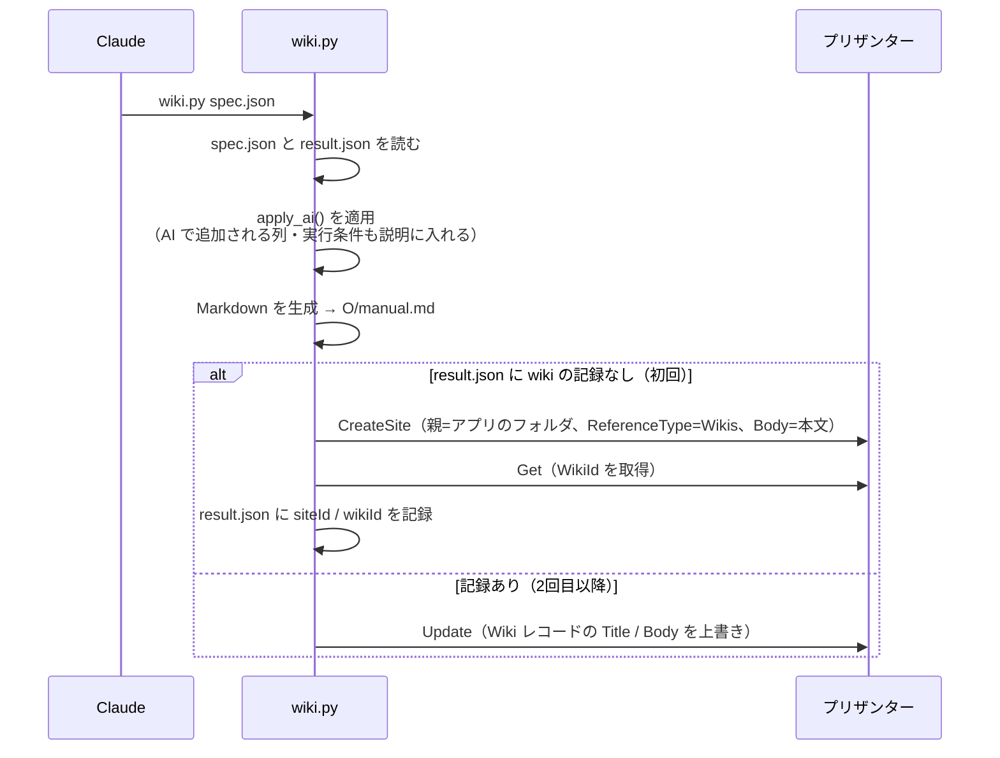
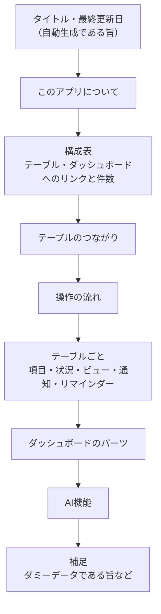

# 13 説明書の自動生成（Wiki）

> この資料は、筆者が個人で作成した非公式のメモです（多くを AI が書いています）。プリザンターの正確な仕様は公式マニュアル（原稿: https://github.com/Implem/Implem.Pleasanter.Manual ）を参照してください。

## 13.1 目的と考え方

アプリを作るたびに、利用者向けの説明書を自動で作る。spec.json を唯一の情報源にして Markdown を生成し、アプリのフォルダ内に Wiki として登録する。

- 説明文を設定から作るので、設定と説明書が食い違わない。
- spec を直して再生成すれば、説明書も追従する。

```text
PYTHONUTF8=1 python -P .claude/skills/pleasanter-app/scripts/wiki.py <spec.json> [--dry-run]
```

`--dry-run` を付けると、`O\manual.md` を書くだけで登録はしない。

## 13.2 処理の流れ



Wiki は、CreateSite で `ReferenceType=Wikis` と Body を渡すと Wiki レコードも一緒に作られる。更新は Wiki レコードの ID に対する `Update` で行う（package-format.md に追記された事実）。

## 13.3 情報源

| 説明書の内容 | spec のどこから作るか |
|---|---|
| このアプリについて | 最上位の `description` |
| 構成表 | `tables`（`description`、result.json の件数・SiteId）、`dashboards`（`description`）、`ai`（`description`） |
| テーブルのつながり | 列の `link` |
| 操作の流れ | 最上位の `usage`（文字列の配列） |
| 各テーブルの説明 | テーブルの `description` |
| 項目 | `columns`（label、種類、必須、選択肢、列の `description`） |
| 自動計算・自動集計の説明 | `formulas` の式、他テーブルの `summaries` |
| 状況・ビュー・通知・リマインダー | `status`、`views`、`notifications`、`reminders` |
| ダッシュボード | `dashboards` の parts、cards、charts |
| AI機能 | `ai`（対象、実行のタイミング、渡す項目、書き込む項目、モデル） |

## 13.4 説明書の構成



SaaS営業アプリで生成した `output\SaaS営業 顧客・案件管理\manual.md` は229行である。

### 自動で付く説明の例（案件テーブルの項目表から抜粋）

| 項目 | 種類 | 必須 | 選択肢・補足 |
|---|---|---|---|
| 顧客 | リンク（顧客） | ○ | - |
| MRR | 数値 |  | 自動計算: ライセンス数 * 月額単価 |
| 年間契約額 | 数値 |  | 自動計算: ライセンス数 * 月額単価 * 12 |
| 活動回数 | 数値 |  | 自動集計: 営業活動の件数（実施済のみ） |
| AI: 失注リスク | 選択 |  | 高、中、低 |

- 計算式は列名（`NumA` など）を表示名に置き換えて書く。
- Summary は、集計元のテーブル・集計の種類・ビュー条件から「自動集計: 営業活動の件数（実施済のみ）」のような文を作る。
- AI機能で追加される列（トリガーのチェック、出力列、AI実行記録）も項目表に出る。

### 通知・リマインダーの文の例

> 通知: 「案件を受注しました」 … 受注になったとき [Manager],[Owner] にメール
> リマインダー: 「受注予定日が14日以内の進行中案件」 … 受注予定日の14日前から毎日 [Owner] にメール（対象: 進行中）

### AI機能の節

対象、実行のタイミング（「『AIで商談を分析する』をオンにして保存したとき」）、AI に渡す項目、結果を書き込む項目、使用モデルと所要時間の目安、送信先が外部の AI API であることを書く。

## 13.5 制約

| 制約 | 対応 |
|---|---|
| 本文は先頭が `[md]` のときだけ Markdown として描画される。付けないと記号がエスケープされたメモ表示になる | wiki.py が本文の先頭に `[md]` を付けて登録する（手元の manual.md には付けない） |
| プリザンターの Wiki は Mermaid を描画しない | 図を使わず、表と箇条書きで書く |
| 手で編集した内容は、再生成で上書きされる | 説明書の冒頭と補足にその旨を書いている。直したいときは spec の `description` / `usage` を直す |
| 状況は定義の順に「→」で並べるだけ | 実際の遷移（例: 失注は受注の次ではない）は表していない |
| 説明の質は spec の `description` / `usage` に左右される | 書かれていなければ、その節は出ない |

## 13.6 実績

| 項目 | 値 |
|---|---|
| アプリ | SaaS営業 顧客・案件管理 |
| Wiki の SiteId | 48493 |
| WikiId | 48494 |
| 生成した行数 | 229行（manual.md） |

> **プリザンターの性質との関係**: Wiki も API で作成・更新できるので、アプリと説明書を同じ spec.json から同時に作れる。設定と説明書が食い違わない。
