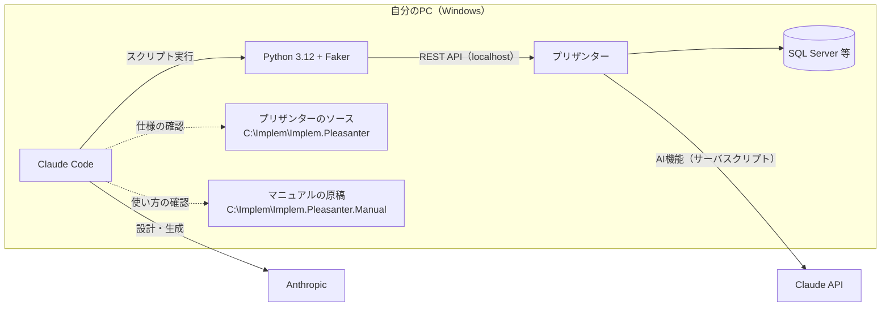

# 環境の作り方

このツールを自分の PC で動かすための準備手順です。所要時間の目安は、プリザンターのインストールを含めて 1〜2 時間です。

> このフォルダの内容は AI によるバイブコーディングで作成した参考実装です。検証用の PC で試し、
> 業務データや本番環境では使わないでください（詳しくは `README.md`）。

## 全体像



## 1. 必要なもの

| もの | 用途 | 備考 |
|---|---|---|
| Windows 10/11 | 動作確認した OS | PowerShell 5.1 / Git Bash を使う |
| プリザンター 1.5 系 | アプリの作成先 | ローカル（localhost）で動かす |
| データベース | プリザンターの保存先 | 動作確認は SQL Server。PostgreSQL / MySQL でも動く想定（未確認） |
| Git | 公開リポジトリのクローン | |
| Python 3.12 以上 | スクリプトの実行 | Faker を追加インストール |
| Claude Code | AI によるアプリの設計・作成 | Anthropic のアカウントが必要 |
| Claude API のキー | アプリに組み込む AI 機能 | 使わない場合は不要（AI 機能の動作確認が NG になる） |

## 2. プリザンターをインストールする

プリザンターのマニュアルの手順に従ってインストールします（マニュアルの原稿は 3. でクローンします）。

| やり方 | マニュアルのページ（`ja/docs/` からのパス） |
|---|---|
| Windows にインストーラで入れる（おすすめ） | 「インストーラでプリザンターをWindowsにインストールする」`setup/installation/install-with-installer/getting-started-installer-pleasanter-windows.md` |
| データベース（SQL Server 2022 Express） | 「SQL Server 2022 Expressのインストール及び設定」`setup/installation/install-database/install-sql-server2022-express.md` |
| Docker で動かす | 「Dockerで起動する」`setup/installation/running-with-docker/getting-started-pleasanter-docker.md` |
| 事前の注意事項 | 「インストール時の注意事項」`setup/installation/prerequisites/index.md` |

インストール後、ブラウザで `http://localhost:<ポート>/` を開いてログインできることを確認します。

## 3. 公開リポジトリをクローンする

Claude Code が仕様を確かめるために、プリザンターのソースとマニュアルの原稿を手元に置きます。
どちらも GitHub で公開されています。**`CLAUDE.md` と reference はこの場所を前提にしているので、パスを変えないでください。**

```bash
cd /c/Implem
git clone https://github.com/Implem/Implem.Pleasanter.git
git clone https://github.com/Implem/Implem.Pleasanter.Manual.git
```

| 場所 | 内容 |
|---|---|
| `C:\Implem\Implem.Pleasanter\Implem.Pleasanter` | プリザンター本体のソース（AGPL-3.0） |
| `C:\Implem\Implem.Pleasanter.Manual\ja\docs` | マニュアルの原稿（日本語） |
| `C:\Implem\pleasanter-app-builder` | このリポジトリをクローンした場所 |

- ソースは、インストールしたプリザンターと**同じバージョン**のタグを使うのが確実です
  （例: `git -C Implem.Pleasanter checkout <バージョンのタグ>`）。reference に書いたファイルの行番号は作成時点のもので、数行ずれることがあります。
- ソースは「読むため」だけに使います。ビルドや改変は不要です。

## 4. プリザンターの API キーを作る

1. プリザンターにテナント管理者でログインします。
2. マニュアル「APIキーの作成」（`developers-guide/api/basics/api-key.md`）の手順で API キーを作ります。
3. スクリプトはこのキーでサイトの作成・削除を行います。**検証用のテナント**で、管理者権限のあるユーザーのキーを使ってください。

## 5. Python と Faker を入れる

```bash
python --version          # 3.12 以上
python -m pip install --user faker
PYTHONUTF8=1 python -P -c "from faker import Faker; print(Faker('ja_JP').company())"
```

- スクリプトは `PYTHONUTF8=1 python -P` で実行します（`-I` だとユーザー領域の Faker が読めない、UTF8 指定がないと文字化けする）。

## 6. Claude Code を入れる

Claude Code をインストールし、Anthropic のアカウントでログインします（https://claude.com/claude-code ）。
このフォルダで起動すると、`CLAUDE.md` とスキル（`.claude/skills/pleasanter-app`）、許可リスト（`.claude/settings.json`）が自動で読み込まれます。

## 7. secret.txt を書く

`secret.txt.example` を `secret.txt` という名前でコピーし、自分の環境の値を書き入れます（`secret.txt` は `.gitignore` でコミットの対象から外しています）。

```
PleasanterApiUrl:http://localhost:<ポート>/api/items/
PleasanterApiKey:<4. で作ったプリザンターのAPIキー>
ClaudeApiKey:<Claude API のキー>
```

- `PleasanterApiUrl` に localhost と `plapi.py` の `ALLOWED_REMOTE_HOSTS` 以外を指定すると、スクリプトが接続を拒否します（誤って社外・本番に送らないため）。
- `secret.txt` は他人に渡したり、Git にコミットしたりしないでください。

## 8. （任意）SysLogs を確認できるようにする

画面に「アプリケーションで問題が発生しました。」と出たときに、原因を DB の SysLogs から読むためのスクリプト（`scripts/syslogs.py`）があります。
使う場合は次を用意します（SQL Server の場合）。

- sqlcmd（`C:\Program Files\Microsoft SQL Server\Client SDK\ODBC\180\Tools\Binn\sqlcmd.exe`）
- 環境変数 `Implem.Pleasanter_Rds_SQLServer_UserConnectionString` にプリザンターの接続文字列
  （マニュアル「資格情報をシステム環境変数に登録する」`setup/parameters/credentials-in-environment-variables.md`）

## 9. 動作を確認する

このフォルダで Claude Code を起動し、次のように頼みます。

```
/pleasanter-app 問い合わせ管理
```

または、見本の spec をそのまま使って、スクリプトだけで確認することもできます。

```bash
cd /c/Implem/pleasanter-app-builder
mkdir -p "output/問い合わせ管理"
cp .claude/skills/pleasanter-app/examples/compact/spec.json "output/問い合わせ管理/"
PYTHONUTF8=1 python -P .claude/skills/pleasanter-app/scripts/make_app.py "output/問い合わせ管理/spec.json"
```

最後に表示される URL を開き、テーブル・ダッシュボード・説明書 Wiki ができていれば準備完了です。
作ったアプリを消すときは `delete.py <SiteId>` で対象を確認してから `--yes` を付けて実行します。

## うまくいかないとき

| 症状 | 確認すること |
|---|---|
| `接続先が localhost ではないため中止しました` | `secret.txt` の `PleasanterApiUrl` |
| API が 401 / 403 | API キーの値、キーを作ったユーザーの権限 |
| 日本語が文字化けする | `PYTHONUTF8=1` を付けているか |
| `No module named 'faker'` | `-I` ではなく `-P` で実行しているか、Faker を入れたか |
| AI 機能の動作確認が NG | `ClaudeApiKey`、PC からインターネット（api.anthropic.com）へ出られるか |
| 画面に「アプリケーションで問題が発生しました。」 | `syslogs.py 60 --stack` でエラーの中身を見る |
